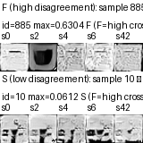

# FMNIST tiny cross-model — interpretation-focused report

**F/S (throughout):** F = high **cross-model disagreement**, S = low disagreement (top/bottom 10% pairwise LPIPS). **Not** semantic image quality or success/failure.

---

## 1. Big picture

This experiment is **not** only about confirming that five models produce different images. With the **same fixed noise** through **five independently trained** FashionMNIST tiny diffusion models, we ask: (1) **which sample ids** end up with high disagreement at the end; (2) when that **identity stabilizes** along **training checkpoints**; (3) at which **denoising τ** it becomes apparent in one trajectory; and (4) whether final high-disagreement samples form **local neighborhoods** in **state space**.

**Retention** = how much disagreement **identity persists** over **time** (training step, denoising τ). **Neighborhood analysis** = whether those samples **sit close together** in mean-state space (kNN enrichment; UMAP as support). Retention tracks **temporal persistence**; neighborhood analysis tracks **spatial organization** in state space.

We fix **100** highest-disagreement ids at final (ckpt 46000, τ=0) and assess **id persistence** and **neighbor structure** across earlier checkpoints and τ.

---

## 2. Experimental setup

| Item         | Detail                                                                                                       |
| ------------ | ------------------------------------------------------------------------------------------------------------ |
| Model        | FashionMNIST **tiny** unconditional diffusion UNet (32×32, 1ch)                                              |
| Models       | **5**, identical architecture / data / hyperparameters; **training seeds** 0, 2, 4, 6, 42 only               |
| Checkpoints  | 1000, 5000, 10000, 15000, 20000, 25000, 30000, 35000, 40000, **46000**                                       |
| Noise        | **1000** fixed Gaussian ε (`fixed/fixed_noise_1000.pt`); **same noise id** everywhere                        |
| Sampling     | **DDIM**, η=0; **one** pass **999→0**; snapshots τ = 999, 750, 500, 250, 0                                   |
| Disagreement | 5 outputs → **10 pairwise LPIPS** → **max** / **mean** (**max-F** primary; mean = supporting consistency)    |
| F / S        | Per `(checkpoint, τ)`, top **10% = F**, bottom **10% = S** on 1000 scores                                    |
| τ=999        | Shared ε before first UNet step → LPIPS=0, **F/S N/A**                                                       |
| Baseline ids | **Ckpt 46000, τ=0**: max-F / max-S (and mean-F/S) **100** ids each (`baseline/baseline_ckpt46000_tau0.yaml`) |

Manifold: τ **750, 500, 250, 0** only. Mean of 5 states → 1024-d; per-τ shared PCA-50 → UMAP / kNN.

F/S mark **cross-model spread**, not image quality. Below: max-F sample 885 vs max-S sample 10 at ckpt 46000, τ=0 (five-model grids, definition check).

*Path:* `visualizations/2026-10-01_identity-retention/compare_F885_vs_S10_tau0_max.png` — F = divergent outputs; S = similar. Do not read F as “bad image.”

---

## 3. Why retention analysis?

Re-selecting top 100 F at each checkpoint never tells us whether the **same noise id** stays a disagreement case.

We **fixed** **100 baseline max-F ids** from **final τ=0** and measured **retention**: fraction still **F** at each `(checkpoint, τ)`. Retention **0.81** means **81 of 100** final-F samples are again **F** there (`matrix_baseline_max_F.csv`).

---

## 4. Temporal result — training axis (τ=0)

**Source:** `visualizations/retention/matrix_baseline_max_F.csv`, row **τ=0**.

| checkpoint | 1000     | 5000 | 10000 | 15000    | 20000    | 25000 | 30000    | 35000 | 40000    | 46000    |
| ---------- | -------- | ---- | ----- | -------- | -------- | ----- | -------- | ----- | -------- | -------- |
| retention  | **0.06** | 0.12 | 0.12  | **0.21** | **0.43** | 0.45  | **0.58** | 0.67  | **0.81** | **1.00** |

At ckpt **1000**, τ=0, retention **0.06** → final F identity is **barely preserved**. With training, the same ids are **more often** high-disagreement again (20k **0.43**, 30k **0.58**, 40k **0.81**) — **gradual stabilization**, not a fixed identity from the start.

Higher retention near the final checkpoint is **partly expected**; do not infer **causality** from retention alone. What matters more than “late retention is high” is where the rate of increase steepens, and whether sample-specific onsets exist. (mean-F: same qualitative trend.)

---

## 5. Temporal result — denoising axis

**Source:** same CSV. Late checkpoints **40000** / **46000**, baseline **max-F**.

| τ   | retention @ ckpt **40000** | retention @ ckpt **46000** |
| --- | -------------------------- | -------------------------- |
| 750 | **0.22**                   | **0.23**                   |
| 500 | **0.22**                   | **0.23**                   |
| 250 | **0.29**                   | **0.29**                   |
| 0   | **0.81**                   | **1.00**                   |

At a late model, **τ=750/500** overlap **~0.22**; at **τ=0**, **0.81** (46k·τ=0 **1.00** is definitional). Identity **aligns more strongly** toward **late denoising**. Prefer **“more apparent / aligned”** over **“failure is determined at τ=X.”**

The heatmap below shows **F retention** for the anchored **100** ids over **checkpoint (columns) × τ (rows)**. Row τ=999 is N/A (shared ε).

*How to read:* Darker = higher fraction of baseline F ids still **F** at that (checkpoint, τ). **Late checkpoint + late τ** tend darker, matching the tables above. Do not treat color alone as a **decision point**.

---

## 6. Why retention alone is not enough

Some retention patterns are **predictable** (near final ckpt, near τ=0). Retention motivates **follow-ups**:

1. When does each sample first become **stably** high-disagreement?
2. Are onsets **synchronized** or **heterogeneous**?
3. Once F, does a sample **stay** F?
4. Do F samples share **spatial** structure?

---

## 7. Spatial / neighborhood — method

Per `(checkpoint, τ, sample_id)`: **mean** of 5 states → **1024-d** vector. Per τ: concatenate all points → **PCA-50** (shared) → **UMAP-2** (support). **kNN (k=10)** within each 1000-point block in PCA-50. For each baseline max-F id: neighbor F fraction → **mean F-neighbor fraction**. Random expectation **≈ 0.10**.

---

## 8. Spatial result — kNN enrichment

**Source:** `visualizations/manifold/neighborhood_summary.csv`, label=F, k=10.

| Case               | checkpoint | τ   | mean F-neighbor |
| ------------------ | ---------- | --- | --------------- |
| Weakest (τ=0)      | 1000       | 0   | **0.087**       |
| Late ckpt, early τ | 40000      | 750 | **0.153**       |
| Final              | 46000      | 0   | **0.378**       |

**0.087** at 1k, τ=0 ≈ random **0.10** → little early **spatial** grouping. **0.378** at 46k, τ=0 **above** random → **local neighborhood enrichment**. **0.378 ≠ 1.0** → not one **clean, isolated F cluster**.

**High-disagreement samples develop local spatial enrichment, but not a single cleanly isolated cluster.**

Below: mean F-neighbor fraction vs checkpoint (lines = τ). Dashed **0.10** = random reference.

*How to read:* τ=0 rising above **0.10** at late checkpoints matches stronger spatial enrichment. Do not infer mechanism from line crossings alone.

---

## 9. Spatial result — UMAP (supporting)

**kNN is main evidence**; UMAP is **qualitative support** only — do not infer clusters from UMAP alone.

Shared embedding at τ=0 (panel = checkpoint). Early panels: F/S/M **mixed**. Late panels: F **more often** in **local regions**, not a **fully separated island**. Prefer **“increasing local organization”** over **“a manifold exists.”**

*Path:* `visualizations/2026-10-01_identity-retention/umap_tau0_checkpoints.png` — red=F, blue=S, gray=M (baseline max @ 46000 τ=0). **Same UMAP coordinates** across panels.

---

## 10. Connecting temporal and spatial results

| Question           | Tool       | Measure                             |
| ------------------ | ---------- | ----------------------------------- |
| When stable?       | Retention  | Baseline **F label** persistence    |
| Spatial structure? | kNN / UMAP | **F neighbors** in mean-state space |

Both (max-F): early training / early–mid τ **weak**; late training / late denoising **stronger**.

**Possible interpretation (not causal):** identity appears to gain **temporal persistence** and **spatial organization** together as training and denoising progress. **0.378** (not **1.0**) leaves **multiple local modes** as **future hypothesis**, not a claim of one manifold.

---

## 11. Open question

At (46000, τ=0), F-neighbor **0.378**, not **1.0**. **Hypothesis (unproven):** high-disagreement behavior may span **several local modes**, not one manifold; identity may **stabilize** without **one spatial collapse**.

---

## 12. What we can and cannot claim

**Supported by data:** max-F retention **increases** with training (τ=0); stronger **align** at late denoising; F-neighbor **above 0.10** late (max **0.378**); no **perfectly isolated** F cluster in UMAP + kNN.

**Not claimed:** semantic failure; **causal** mechanisms; exact **decision** checkpoint/τ; **unique** failure manifold; predictive failure models.

---

## 13. Synthesis

Retention: anchored **100** ids **align** more with final max-F toward **late training and late denoising**. Neighborhood: **0.378** vs random **~0.10** at final (46000, τ=0). **Temporal persistence** and **partial spatial organization** strengthen together, but enrichment is not **100%**, so a **single separated manifold** is **not** established.

---

## 14. Summary

With the **same fixed noise** in five models, final high-disagreement identity is **poorly preserved** early (**retention 0.06** at 1k, τ=0), **stabilizes** late (**0.81** at 40k, τ=0), and **strengthens** toward **late denoising** (**0.22** → **0.81** at 40k). F-neighbor rises to **~38%** vs **10%** random — **local structure**, closer to **partial local organization** than a **cleanly separated manifold**.

---

*Figures:* `visualizations/2026-10-01_identity-retention/` · *Follow-up:* [`2026-10-06_compactness-separation.md`](2026-10-06_compactness-separation.md)