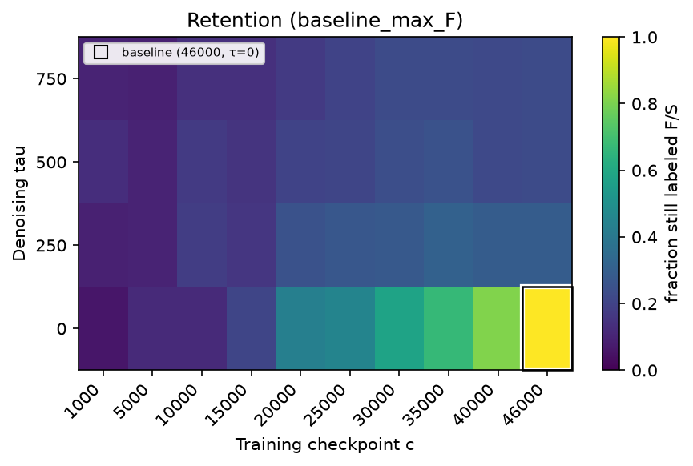
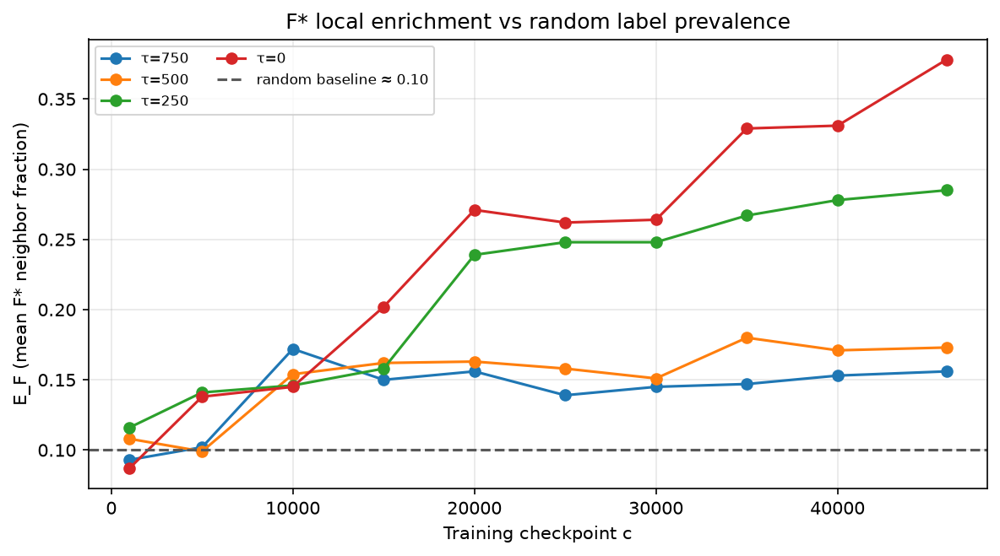
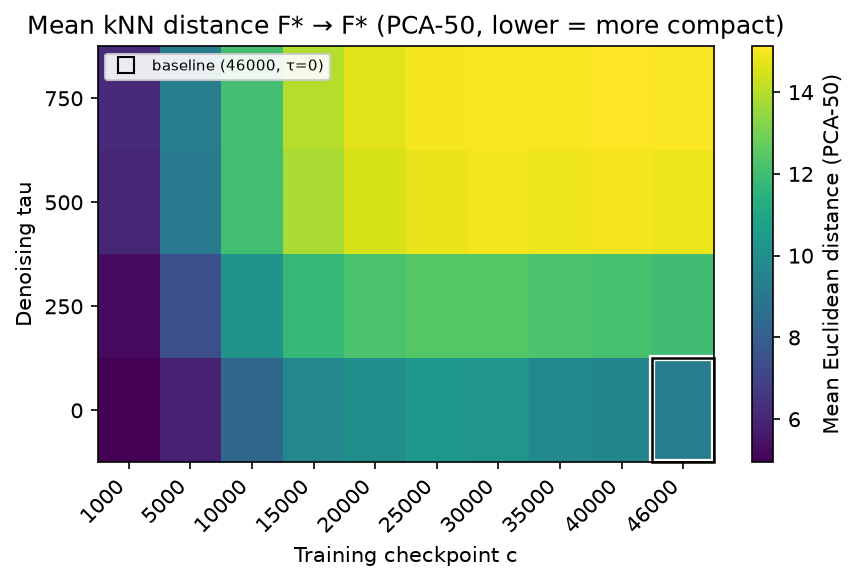
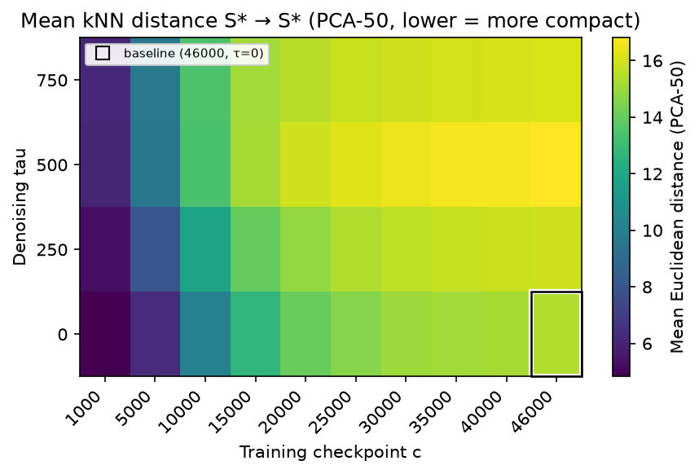
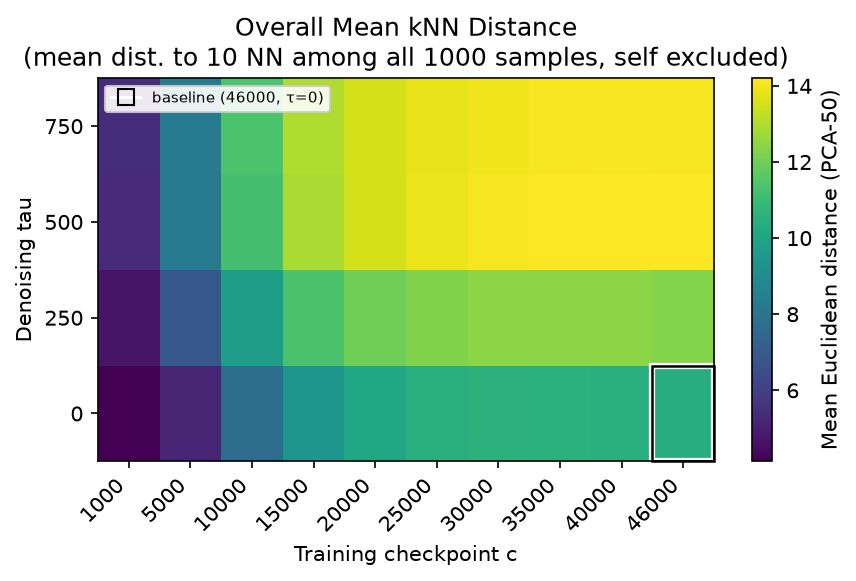
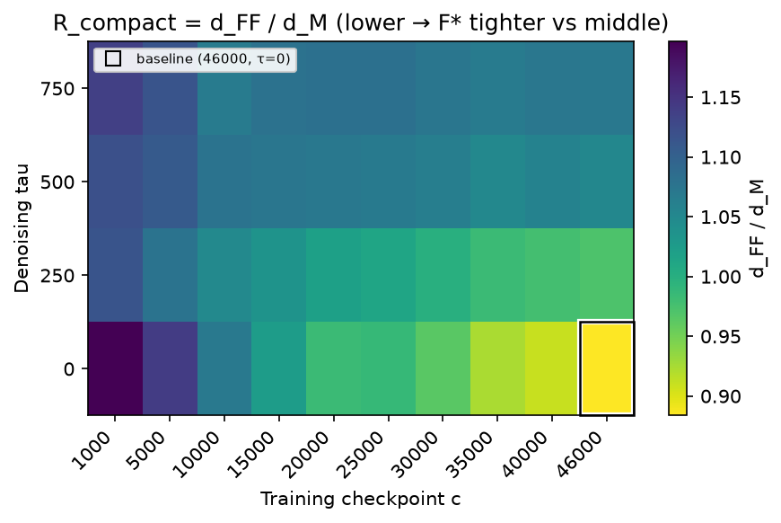
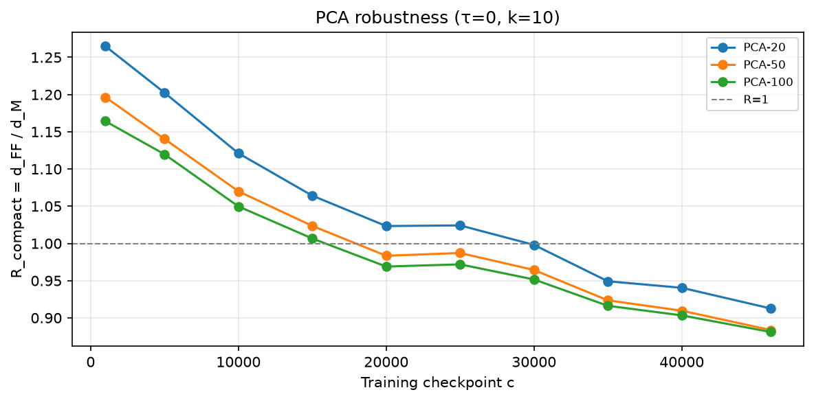
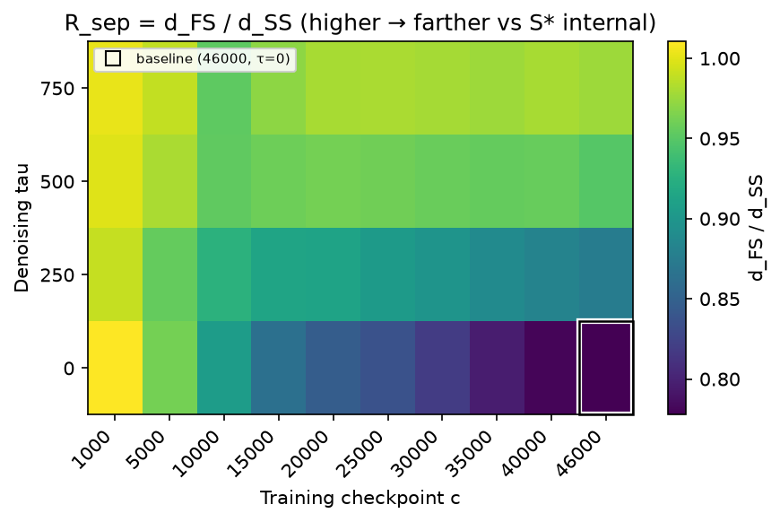
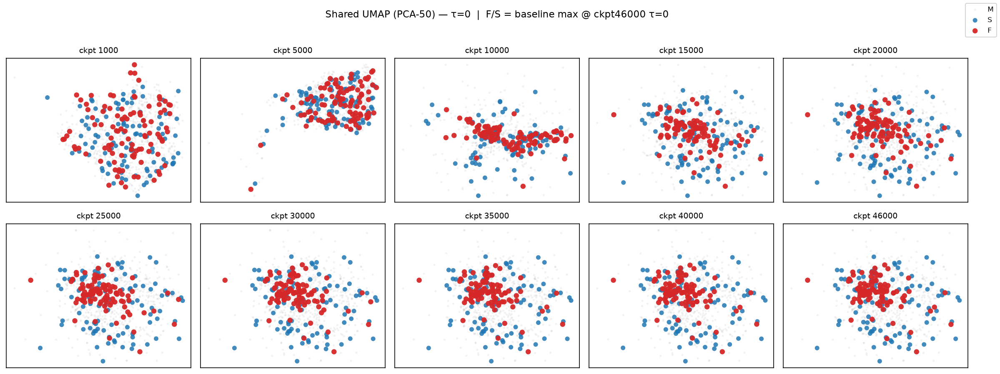

# FMNIST tiny cross-model — Next meeting report (continuation)

**F/S:** high / low **cross-model disagreement** (LPIPS). **Not** semantic failure or image quality.

---

## Previous observation → Open questions → This report

**Previous observation.** Final high-disagreement identity (F∗) becomes **more stable** late in training and denoising (retention ↑). Anchored F∗ show **local enrichment**: fraction of F∗ among kNN neighbors rises above random (**~0.10**) to **~0.378** at final (c=46000, τ=0).

**Open questions.**

1. Does “many F neighbors” mean F∗ points are **geometrically close**?
2. If F∗ tighten, do they also **separate from** S∗?
3. Is that **F-specific**, or **global state-space scaling**?

**This report.** We answer with direct kNN distances `d_FF`, `d_SS`, `d_FS`, `d_SF` and relative baselines `R_compact`, `R_sep` on anchored F∗, S∗ (no new training or sampling; existing trajectories and `distance_summary.csv`).

| Symbol   | Meaning                                                                     |
| -------- | --------------------------------------------------------------------------- |
| *c*      | training checkpoint                                                         |
| *τ*      | denoising timestep                                                          |
| F∗       | final anchored high-disagreement ids (max, *n*=100)                         |
| S∗       | final anchored low-disagreement ids (max, *n*=100)                          |
| z_i(c,τ) | PCA-50 mean-state; **one PCA basis per τ**, shared across all checkpoints c |
| *k*      | nearest neighbors (*k*=10)                                                  |

*Earlier narrative:* `[2026-10-01_identity-retention.md](2026-10-01_identity-retention.md)` (**unchanged** by this document).

---

# 1. What did the previous report establish?

**Temporal.** We fixed **100** final F∗ ids and measured retention `R_F`: overlap with the **top-10% set recomputed from 1000 scores at each** (c,τ). Early (c=1000, τ=0): `R_F` ≈ 0.06. Late: `R_F` ≈ 0.81 at c=40000, τ=0.

**Spatial (enrichment).** Mean fraction of F∗ among kNN of anchored F∗ (`E_F`); pool = all 1000, self excluded. Random ≈ 0.10; final `E_F` ≈ 0.378.

**Unresolved limitation.** `E_F` answers label over-representation, not geometric compactness or F∗/S∗ separation → motivates distance analysis below.

---

# 2. When does final disagreement identity stabilize?

As training progresses, a **fixed final** F∗ id is more often **high-disagreement again** at earlier checkpoints. Thresholds are **recomputed per** (c,τ) from 1000 scores — we do **not** fix a single final LPIPS cutoff.

$$
F(c,\tau) = \text{top-10\% ids ranked by disagreement at }(c,\tau)
$$

$$
R_F(c,\tau) = \frac{\left|F^{\ast} \cap F(c,\tau)\right|}{\left|F^{\ast}\right|}
$$

*Plain English:* “Among final F∗, what fraction is still in the local top-10% at this (c,τ)?”

**Figure 1.** Retention `R_F(c,τ)` for baseline max-F∗.

- **Higher** color = more identity persistence.
- **Observation:** retention rises along late c and late τ; near zero at early c.
- **Caution:** not a causal “decision time.”

> **Reference:** random overlap ≈ **0.10** (local F is 10% of 1000 samples, so expected overlap with a random local-F draw).

**Key numbers (τ=0):** c=1000 **0.06** → 20000 **0.43** → 40000 **0.81** → 46000 **1.00**. At c=40000: τ=750 **~0.22** vs τ=0 **0.81**.

> **Caution.** Retention is label overlap, not embedding distance.

---

# 3. Does local enrichment mean F∗ is actually compact?

For each checkpoint *c*, we independently define a local top-10% set at each denoising timestep *τ* ∈ {750, 500, 250, 0}. Each of these four local sets is then compared against the fixed final anchor F∗, defined at (*c*=46000, *τ*=0).

$$
E_F(c,\tau) = \frac{1}{\left|F^{\ast}\right|} \sum_{i \in F^{\ast}} \frac{\left|\{ j \in N_k(i) : j \in F^{\ast} \}\right|}{k}
$$

$$
\left|F^{\ast}\right| = 100,\qquad k = 10
$$

*Plain English:* Here, |F∗| = 100 and k = 10. For each anchored F∗ sample, we compute the fraction of its 10 nearest neighbors that are also in F∗, then average that fraction across all 100 anchored F∗ samples.

**Figure 2.** `E_F` vs training checkpoint (curves per τ).

- **Higher** = more F∗ neighbors.
- **Observation:** ~**0.09** early → ~**0.38** late (ckpt 46k, τ=0).
- **Caution:** 0.378 is not a cluster (fraction only).

> **Limitation — Enrichment tells us:** “Are F∗ labels locally over-represented?”  
> **It does NOT directly tell us:** geometric compactness or F∗/S∗ separation.

**Geometric distances** (Euclidean kNN in PCA-50; **same τ shares one PCA basis across all c**):

$$
d_{FF}(c,\tau) = \frac{1}{\left|F^{\ast}\right|} \sum_{i \in F^{\ast}} \frac{1}{k} \sum_{j \in \mathrm{NN}_k^{F^{\ast}}(i)} \left\| z_i - z_j \right\|_2
$$

$$
\left|F^{\ast}\right| = 100,\qquad k = 10
$$

*Plain English:* Here, |F∗| = 100 and k = 10. For each anchored F∗ sample, we find its 10 nearest **other** F∗ samples in PCA-50 space, average those 10 Euclidean distances, and then average that value across all 100 anchored F∗ samples.

$$
\begin{aligned}
d_{SS}(c,\tau) &:\ \text{mean kNN within anchored } S^{\ast} \\
d_{FS}(c,\tau) &:\ F^{\ast} \rightarrow S^{\ast} \text{ cross distance} \\
d_{SF}(c,\tau) &:\ S^{\ast} \rightarrow F^{\ast} \text{ cross distance}
\end{aligned}
$$

- `**d_FF`:** F∗ → F∗ internal kNN distance — lower `d_FF` = F∗ more compact with each other.
- `**d_SS`:** S∗ → S∗ internal kNN distance — lower `d_SS` = S∗ more compact with each other.
- `**d_FS`:** F∗ → S∗ cross-kNN distance — directional proximity from anchored F∗ toward S∗.
- `**d_SF`:** S∗ → F∗ cross-kNN distance — directional proximity from anchored S∗ toward F∗.

**Figure 3a.** Heatmap of `d_FF` (lower = tighter among anchored F∗).

- **Observation:** at τ=0, `d_FF` decreases or plateaus toward late c; high τ plateaus.
- **Caution:** do not compare raw magnitudes across τ.

**Figure 3b.** Heatmap of `d_SS` (internal kNN within S∗).

- **Observation:** at τ=0, `d_SS` keeps rising late while `d_FF` falls — diverging internal geometry.

**Result (τ=0, along *c*).**

| Checkpoint *c* | `d_FF` | `d_SS` |
| -------------- | ------ | ------ |
| 1000           | 4.94   | 4.83   |
| 20000          | 10.02  | 14.01  |
| 46000          | 9.21   | 15.39  |

- `**d_FF`:** non-monotone along *c*; late ↓ (46000 vs 20000).
- `**d_SS`:** rises along *c* (↑).
- **At *c*=46000:** `d_FF` < `d_SS`.

> **Caution.** Small `d_FF` does not prove a cluster or manifold; see §4 for scale.

---

# 4. Is the apparent compactness just global scaling?

We view **failure / success / overall** neighborhood scale in the same (c,τ) representation. The **overall** sanity check here is `d_all` (not the main story).

$$
d_{\mathrm{all}}(c,\tau) = \frac{1}{N} \sum_{i=1}^{N} \frac{1}{k} \sum_{j \in \mathrm{NN}_k^{\mathrm{all}}(i)} \| z_i - z_j \|_2
$$

- N = 1000, k = 10, neighbor pool = **all 1000**, self excluded.

*Plain English:* “How far is a typical sample from its neighbors in the full state space?”

| Metric  | Role                                                              |
| ------- | ----------------------------------------------------------------- |
| `d_FF`  | F∗ internal geometry                                              |
| `d_SS`  | S∗ internal geometry                                              |
| `d_all` | **overall** 1000-sample neighborhood scale (sanity check)         |
| `d_M`   | middle-800 query baseline for `R_compact` (ratios use `d_M` only) |

**Figure 4a.** Overall mean kNN distance `d_all` (supporting). We read **c** within the same τ (do not compare raw magnitudes across τ). Mid-training scale expansion; late largely plateau.

**τ=0 — global scale vs F/S divergence (along c):**

| Checkpoint *c* | `d_FF` | `d_SS` | `d_all` | `d_M` |
| -------------- | ------ | ------ | ------- | ----- |
| 1000           | 4.94   | 4.83   | 4.13    | 4.13  |
| 20000          | 10.02  | 14.01  | 10.18   | 10.19 |
| 30000          | 10.24  | 15.07  | 10.61   | 10.62 |
| 40000          | 9.56   | 15.20  | 10.49   | 10.51 |
| 46000          | 9.21   | 15.39  | 10.41   | 10.43 |

**Read by training phase (τ=0)**

| Phase       | *c* window | `d_all`       | Reading                           |
| ----------- | ---------- | ------------- | --------------------------------- |
| Early → mid | 1k → 30k   | 4.13 → 10.61  | Global neighborhood expansion     |
| Mid → late  | 30k → 46k  | 10.61 → 10.41 | Near plateau (overall scale flat) |

**Same late window (30k → 46k) — F∗ vs S∗ internal geometry**

| Metric | *c*=30k | *c*=46k | Trend |
| ------ | ------- | ------- | ----- |
| `d_FF` | 10.24   | 9.21    | ↓     |
| `d_SS` | 15.07   | 15.39   | ↑     |

**Takeaway.** Early/mid raw distance growth largely tracks **global expansion** (`d_all` ↑). Late **F∗ tightening vs S∗ expansion** happens while `d_all` is flat — not explained by overall scale alone.

**Consistency check.** `d_all` and `d_M` follow almost the same trend at every *c* (table above). Definitions differ: `d_all` = mean kNN over **all 1000** queries; `d_M` = same statistic over the **middle 800** only (F∗/S∗ excluded) — supports using `d_M` as the middle baseline for `R_compact`.

---

`R_compact` still uses `**d_M` only** (we do not form a ratio vs `d_all`).

$$
R_{\mathrm{compact}}(c,\tau) = \frac{d_{FF}(c,\tau)}{d_M(c,\tau)}
$$

`d_M`: for each middle 800 sample (excluding F∗, S∗), mean kNN distance with neighbor pool = full 1000 at the same (c,τ) (self excluded).

| Rcompact | Interpretation                    |
| -------- | --------------------------------- |
| < 1      | F∗ internally tighter than middle |
| ≈ 1      | similar local scale               |
| > 1      | F∗ more spread than middle        |

**Figure 4b.** `R_compact` heatmap (lower = stronger relative compactness vs middle).

- **Observation:** at τ=0, decreases with c; late values below 1.
- **Caution:** ratio ≠ discrete cluster.

| c (τ=0) | R_compact |
| ------- | --------- |
| 1000    | **1.196** |
| 20000   | **0.983** |
| 30000   | **0.964** |
| 40000   | **0.910** |
| 46000   | **0.884** |

**Interpretation.** Early: F∗ more spread than middle (>1). Near ~20k ≈ 1. Late: **relative tightening** / **partial local organization**. Late `d_FF` drop is not matched by `d_M` shrinking similarly (46k: `d_M` ≈ 10.43 vs 20k 10.19, `d_FF` 9.21). After the global-scale check (`d_all` plateau), a natural reader question is: **“Is the compactness trend only because we used PCA-50?”** We address that with the sanity check below (not a direct meeting request, but a **scientific robustness question** when interpreting results).

### Is the result sensitive to choosing PCA-50?

All geometry metrics use a **PCA-50 mean-state representation**. We therefore ask whether the late `R_compact` decrease reflects training dynamics or sensitivity to **PCA dimension = 50**.

**Setup.** No new sampling or training — same trajectories and anchored F∗/S∗. Only the PCA dimension changes:

$$
d_{\mathrm{PCA}} \in \{20,\,50,\,100\}
$$

Otherwise identical to the main analysis: **τ=0**, same anchored F∗, same middle-baseline `d_M`, **k=10**, Euclidean distance, same checkpoints, same PCA fitting (fit on all 10k at τ=0, apply to every c). Same metric R_{\mathrm{compact}} = d_{FF}/d_M.

**τ=0 — `R_compact` by PCA dimension:**

| c     | PCA-20    | PCA-50    | PCA-100   |
| ----- | --------- | --------- | --------- |
| 1000  | 1.265     | 1.196     | 1.164     |
| 20000 | 1.023     | 0.983     | 0.969     |
| 30000 | 0.998     | 0.964     | 0.952     |
| 40000 | 0.940     | 0.910     | 0.903     |
| 46000 | **0.913** | **0.884** | **0.881** |

- All three PCA dimensions show **late-training `R_compact` decrease** (same direction 20k → 46k).
- At **46k, all three have `R_compact` < 1** (`R_compact` = 1 is the middle-baseline reference).
- The **PCA-50** column **matches exactly** existing `matrix_ratio_dFF_over_dM.csv` (τ=0) — pipeline consistency.

**Figure 4c.** PCA-dimension robustness of `R_compact` at τ=0. PCA-20, PCA-50, and PCA-100 all show the same late-training decrease, indicating that the **qualitative** compactness trend is **not specific to PCA-50**. `R_compact` = 1 is the middle-baseline reference (dashed).

Exact values vary with PCA dimension, but the **qualitative conclusion is unchanged**: anchored F∗ become **relatively more compact vs middle** late in training. The observed late compactness trend does **not** look like an artifact of choosing PCA-50 specifically (we only checked 20 / 50 / 100; we do not claim dimension-independence). The §4 late relative-compactness conclusion is **further supported** after the global baseline and this representation sanity check.

---

# 5. Are F∗ relatively separated from S∗?

$$
R_{\mathrm{sep}}(c,\tau) = \frac{d_{FS}(c,\tau)}{d_{SS}(c,\tau)}
$$

| Rsep | Meaning                                        |
| ---- | ---------------------------------------------- |
| > 1  | `d_FS` > `d_SS` — relative separation evidence |
| ≈ 1  | `d_FS` ≈ `d_SS`                                |
| < 1  | `d_FS` < `d_SS`                                |

**Figure 5.** `R_sep` heatmap (higher = more relative separation on this metric).

- **Observation:** at τ=0, decreases with c; ≈ **0.78** at ckpt 46k.
- **Caution:** `R_sep` > 1 does not prove a separated cluster; < 1 does not mean complete overlap.

| c (τ=0) | R_sep     |
| ------- | --------- |
| 1000    | **1.010** |
| 20000   | **0.846** |
| 30000   | **0.819** |
| 40000   | **0.781** |
| 46000   | **0.778** |

Training does not strengthen clean separation on this metric; relative separation evidence weakens.

Cross-kNN distance is **directional**, so `d_FS` and `d_SF` need not be equal. At **τ=0** they are nearly identical early, but **asymmetry grows** mid→late (46k: `d_FS`=11.97 vs `d_SF`=14.46); Δ plateaus around 40k–46k. At **τ=500/750** they are nearly symmetric — **late cross-distance asymmetry** is especially visible at **τ=0**. Differences in local density or geometry **may** contribute to asymmetry, but we **do not** assign a mechanistic cause (nor claim asymmetry **causes** no-separation).

**τ=0 — cross distance asymmetry (Δ = d_SF − d_FS):**

| c     | d_FS  | d_SF  | Δ     |
| ----- | ----- | ----- | ----- |
| 1000  | 4.88  | 4.87  | −0.01 |
| 20000 | 11.86 | 13.13 | +1.27 |
| 30000 | 12.35 | 14.33 | +1.98 |
| 40000 | 11.88 | 14.40 | +2.53 |
| 46000 | 11.97 | 14.46 | +2.49 |

---

## Compactness vs Separation

| Question                         | Result                                                                                            |
| -------------------------------- | ------------------------------------------------------------------------------------------------- |
| Do F∗ become relatively compact? | **Yes — late training** (τ=0, `R_compact` down)                                                   |
| Clean separation of F∗ and S∗?   | **No clear evidence** (`R_sep` < 1, downward trend)                                               |
| Only global scaling?             | **Unlikely** — late `d_all` plateau but `d_FF` ↓, `d_SS` ↑                                        |
| Sensitive to PCA-50 choice?      | **No clear sign** — late `R_compact` decrease preserved at PCA-20/50/100 (not specific to PCA-50) |
| One discrete F manifold?         | **Not established**                                                                               |

### Final snapshot (c=46000, τ=0)

| Metric    | Value |
| --------- | ----- |
| d_FF      | 9.21  |
| d_SS      | 15.39 |
| d_FS      | 11.97 |
| d_SF      | 14.46 |
| R_compact | 0.884 |
| R_sep     | 0.778 |

`d_FF` < `d_SS`; `R_compact` < 1 (relative compactness vs middle); **cross geometry is directional/asymmetric** (`d_FS` ≠ `d_SF`); no clean separation.

---

# 6. What does the combined temporal + spatial picture say?

**Early training:** unstable F identity (`R_F` low); similar F/S distances and ratios (`R_compact` ≈ 1.2 early, `R_sep` ≈ 1).

**Middle:** `d_all` rises sharply; broad expansion of raw distances — **global state-space expansion** dominates.

**Late:** `d_all` ≈ **plateau**; `R_F` ↑; `E_F` ↑; `d_FF` ↓; `R_compact` ↓; `d_SS` ↑; `R_sep` ↓.

**Figure 6.** UMAP of mean-states by checkpoint (τ=0).

- **Qualitative supporting only** — do not infer manifold existence.

> **Synthesis.** Temporal persistence and spatial organization emerge together **late in training, after overall neighborhood scale has largely stabilized**; the spatial pattern is better described as **relative local compactness** than as a **separated failure manifold**.

---

# 7. What can we claim — and what can we not claim?

**Can claim (within data and definitions).**

- Final high-disagreement **identity** is **more persistent** late in training and late denoising.
- Anchored F∗ show **relative compactness vs middle** in mean-state PCA space (late, especially τ=0).
- The **late relative-compactness trend (τ=0)** is **qualitatively preserved** across PCA dimensions **20, 50, and 100**.
- Late F∗ tightening is **not explained by overall scale shrink** — `d_all` is largely stable in the same late window.
- Enrichment and distances are **consistent** — local organization signal late; not 100% concentration.

**Cannot claim.**

- Semantic failure cluster, single manifold, clean F–S separation, UMAP isolation, causal claims from retention/distances alone.

---

## Conclusion

1. Final high-disagreement identity becomes **increasingly persistent** late in training and late denoising.
2. The same anchored F∗ become **relatively compact** vs a **middle baseline** (late `R_compact` < 1; **same qualitative trend at PCA-20/50/100**).
3. That compactness does **not** coincide with increasing **clean F–S separation** — **partial local organization** rather than one isolated failure manifold.

---

## Appendix — figures

| Item                       | Path                                                                                       |
| -------------------------- | ------------------------------------------------------------------------------------------ |
| Figure 1 — retention       | `visualizations/2026-10-06_compactness-separation/heatmap_baseline_max_F.png`              |
| Figure 2 — enrichment      | `visualizations/2026-10-06_compactness-separation/f_neighbor_enrichment_by_checkpoint.png` |
| Figure 3a — d_FF           | `visualizations/2026-10-06_compactness-separation/heatmap_d_FF.png`                        |
| Figure 3b — d_SS           | `visualizations/2026-10-06_compactness-separation/heatmap_d_SS.png`                        |
| Figure 4a — d_all          | `visualizations/2026-10-06_compactness-separation/heatmap_d_all.png`                       |
| Figure 4b — R_compact      | `visualizations/2026-10-06_compactness-separation/heatmap_ratio_dFF_over_dM.png`           |
| Figure 4c — PCA robustness | `visualizations/2026-10-06_compactness-separation/tau0_Rcompact_by_pca.png`                |
| Figure 5 — R_sep           | `visualizations/2026-10-06_compactness-separation/heatmap_ratio_dFS_over_dSS.png`          |
| Figure 6 — UMAP            | `visualizations/2026-10-06_compactness-separation/umap_tau0_checkpoints.png`               |
| Prior report               | `[2026-10-01_identity-retention.md](2026-10-01_identity-retention.md)`                     |

*Generated continuation report; does not modify* `[2026-10-01_identity-retention.md](2026-10-01_identity-retention.md)`.