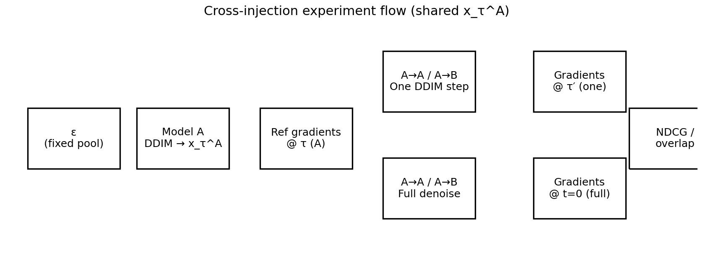
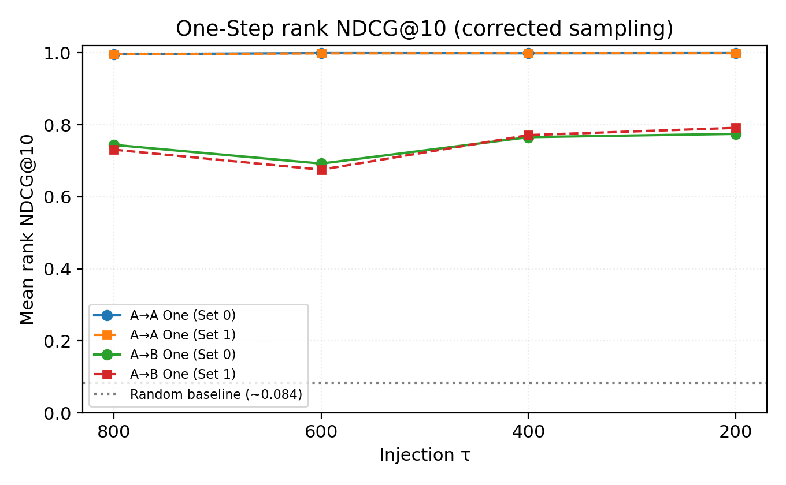
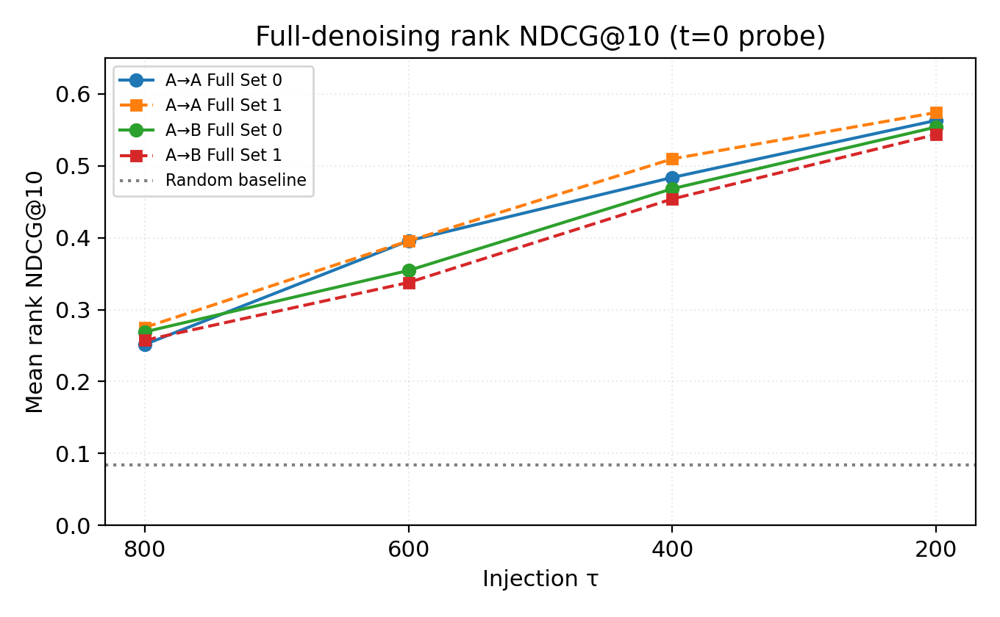
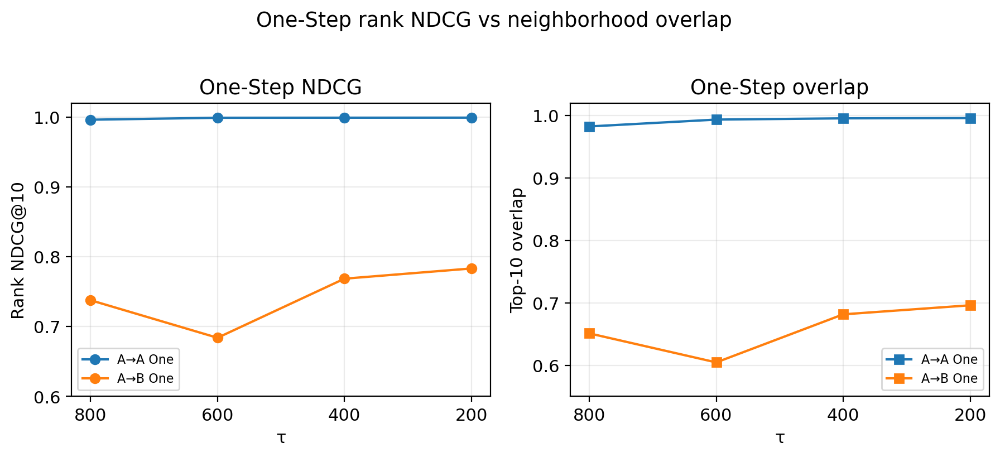
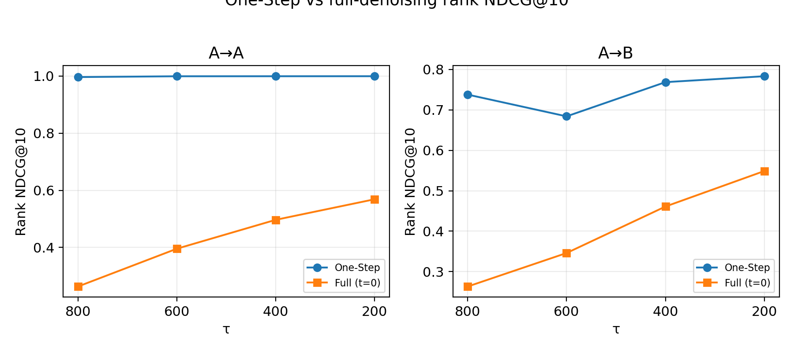
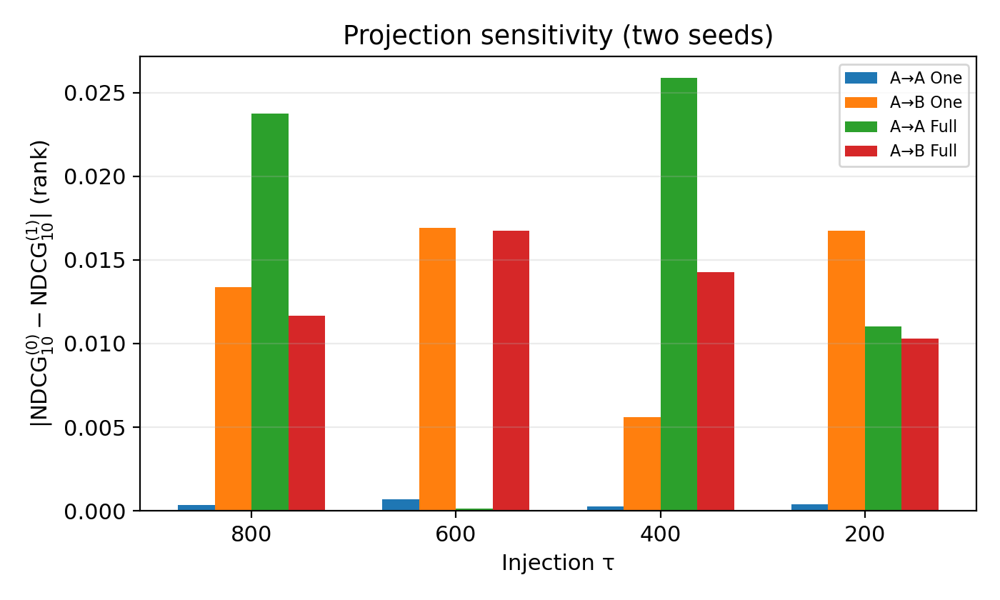
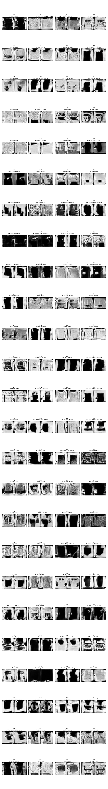

# FMNIST split cross-injection — Gradient proximity (corrected sampling, ckpt 46k)

> **Correction note.** An earlier report used Phase 3 runs where `denoise_until_tau_before_step()` skipped DDIM steps when `t > τ`, so `x_τ^A` was still initial noise. That invalidates all cross-injection neighborhoods from those runs. **This document is the final analysis** after the sampling fix (`sampling_fix_audit_ckpt46000`, `all_pass: true`), **Corrected Phase 3** (`full_ckpt46000_phase3_corrected_20261110`), and **Phase 4** with two independent projection banks (`full_ckpt46000_phase4_proj2_20261110`). Metrics below come only from those roots.

**Scope:** Model A/B class-split unconditional diffusion; shared `x_τ^A` from Model A; injection τ ∈ {800, 600, 400, 200}; mid-block random-projected gradient neighborhoods (N = 100 noise IDs 0–99).  
**Primary source:** `experiments/fmnist_split_cross_injection/full_ckpt46000_phase4_proj2_20261110/merged_report.json` (`validation: ok`). Phase 3 Set 0 (seed 20261109) matches Corrected Phase 3 for parity.

**Notation:** `x_τ^A` = Model-A latent immediately **before** the DDIM update at injection τ; τ′ = next scheduler index (799, 599, 399, 199). Display math uses `$$ … $$`.

---

## 1. Overview

We ask whether **gradient neighborhoods**—peer rankings induced by projected mid-block sensitivities—stay aligned with a reference computed at `x_τ^A` under Model A when subsequent denoising uses Model B.

| Case | Model at probe | Gradient timestep |
| --- | --- | --- |
| Reference | A | τ |
| A→A One-Step | A | τ′ |
| A→B One-Step | B | τ′ |
| A→A Full | A | **t = 0** on final image |
| A→B Full | B | **t = 0** on final image |

**One-Step A→A** should preserve neighborhoods (single in-model DDIM step). **A→B One-Step** stress-tests immediate cross-model sensitivity. **Full** cases evaluate features at the **clean endpoint** (output probe at t = 0), not the autograd Jacobian inside the last DDIM `scheduler.step`.

Phase 4 repeats all gradient metrics under **two projection sets** (seeds 20261109 / 20261110, K = 32 each) while **reusing** the same DDIM latents (`sampling_shared/`).

---

## 2. Experimental Setup

| Setting | Value |
| -------- | ----- |
| Data | FashionMNIST 32×32 grayscale, unconditional |
| Model A classes | 0, 2, 3, 4, 6 |
| Model B classes | 1, 5, 7, 8, 9 |
| Split size | 30,000 images per model |
| Init / training | Same initial weights; independent fine-tuning to **EMA step 46000** |
| Sampling | DDIM, η = 0, 1000 train timesteps |
| Noise anchors | Fixed IDs **0–99** (`fixed_noise_1000.pt`) |
| Injection τ | 800, 600, 400, 200 |
| Projections | **Set 0:** seed 20261109; **Set 1:** seed 20261110; K = 32 directions each |
| Gradients | **U-Net mid block only**; weights frozen except mid block for `autograd.grad` |
| Metrics | Rank- and cosine-grade NDCG@5/@10, top-k overlap, random baseline (50 permutations, seed 20261109) |
| Classifier | ONNX on **full** outputs only (predicted labels; auxiliary) |

**Sampling validation (post-fix):** Independent DDIM trajectory max diff = **0**; τ-wise step counts match; A→A and A→B One-Step share identical `x_τ^A`; model `state_dict` unchanged across cases.

---

## 3. Gradient Proximity

Let ε<sub>θ</sub>(x, t) be the U-Net noise prediction. With output dimension 1024 (= 1×32×32 channels flattened):

$$
z_\theta(x,t)=\operatorname{vec}(\epsilon_\theta(x,t)), \qquad
s_k=r_k^\top z_\theta(x,t), \qquad
g_k=\nabla_{\theta_{\mathrm{mid}}}s_k, \qquad
G_i=\operatorname{concat}(g_1,\ldots,g_{32})
$$

Each r<sub>k</sub> ∈ ℝ<sup>1024</sup> is a fixed unit vector drawn from the projection seed; the bank is shared across all anchors and cases within a projection set. Pairwise similarities:

$$
S_{ij}=\frac{G_i^\top G_j}{\|G_i\|_2\|G_j\|_2}
$$

**Implementation (`gradient_proximity.py`):** Only mid-block parameters receive `requires_grad`; scalars s<sub>k</sub> are backpropped via `torch.autograd.grad` without updating weights. Concatenated dimension **|G<sub>i</sub>| = 88,244,224** (32 × mid-block parameter count, verified in `tau_report.json`).

**Rankings:** For each anchor i, neighbors are sorted by test-case S<sub>ij</sub> (self excluded). The **reference** ranking uses Model A gradients at (`x_τ^A`)<sub>i</sub>, τ.

### NDCG@k

$$
\mathrm{DCG}_k=\sum_{r=1}^{k}\frac{\mathrm{rel}(j_r)}{\log_2(r+1)}, \qquad
\mathrm{NDCG}_k=\frac{\mathrm{DCG}_k}{\mathrm{IDCG}_k}
$$

- **Rank-grade:** Reference top-k neighbors get grades k, k−1, …, 1; others 0 (`rank_grade_relevance`).
- **Cosine-grade:** Relevance of neighbor j is **(S<sup>ref</sup><sub>ij</sub> + 1) / 2**—continuous, so NDCG stays high even when test order reshuffles (`cosine_grade_relevance`).

Test order always follows the **case** similarity matrix; relevance always follows the **reference** matrix (same UNet per case for building G<sub>i</sub>; we compare rankings, not cross-model raw features).

### Top-k overlap

$$
\mathrm{Overlap}_k=\frac{|N_k^{\mathrm{ref}}(i)\cap N_k^{\mathrm{case}}(i)|}{k}
$$

### Switching gap (descriptive)

$$
\Delta_{\mathrm{switch}}(\tau)=\mathrm{NDCG}_{A\to A}(\tau)-\mathrm{NDCG}_{A\to B}(\tau)
$$

(computed on rank or cosine grade; One-Step or Full as noted).

---

## 4. Experimental Design



**Figure 0.** Fixed ε<sub>i</sub> → Model A DDIM to pre-step state at τ → `x_τ^A` → parallel branches (reference @ τ; One-Step @ τ′; Full through t = 0 @ t = 0 probe).

```
Fixed epsilon
     |
     v
Model A DDIM denoising
     |
     v
x_tau_A
     |
     +------ Reference: Model A @ tau
     |
     +------ A -> A: One DDIM step
     |
     +------ A -> B: One DDIM step
     |
     +------ A -> A: Full denoising
     |
     +------ A -> B: Full denoising
```

Phase 4: for each τ, **one** shared sampling artifact tree; gradient passes differ only by projection bank (Set 0 vs Set 1).

---

## 5. Results

Random baseline (rank NDCG@10) ≈ **0.083–0.084** per τ. Below, **μ ± s** is the mean and sample std across **n = 2** projection sets (s = |v<sub>0</sub> − v<sub>1</sub>| / √2 from `merged_report.json`).

### 5.1 Rank NDCG@10 (primary)

| τ | A→A One | A→B One | Δ<sub>switch</sub> | A→A Full | A→B Full |
| ---: | ---: | ---: | ---: | ---: | ---: |
| 800 | 0.9961 | 0.7377 | 0.258 | 0.2634 | 0.2632 |
| 600 | 0.9989 | 0.6839 | 0.315 | 0.3957 | 0.3461 |
| 400 | 0.9990 | 0.7686 | 0.230 | 0.4968 | 0.4611 |
| 200 | 0.9991 | 0.7832 | 0.216 | 0.5687 | 0.5489 |

(μ columns match `combined_tau.*.per_case.*.rank_ndcg10_mean`; Δ from One-Step means.)



**Figure 1.** One-Step **rank** NDCG@10 vs τ; solid = Set 0, dashed = Set 1. A→A ≈ 1.0; A→B **lowest at τ = 600** (~0.684 mean).


**Figure 2.** One-Step **cosine** NDCG@10 (set mean). A→A and A→B remain > 0.98; rank-grade (Figure 1) is the stricter discriminator.



**Figure 3.** Full-denoising rank NDCG@10 (t = 0 probe). Values rise from τ = 800 toward τ = 200 but stay well below One-Step A→A.

### 5.2 Cosine NDCG, overlap, and multi-metric snapshot (τ = 600)

Rank-grade highlights the τ = 600 One-Step dip; cosine-grade and overlap move in the same direction but with smaller dynamic range.

| Case | Rank @5 μ | Rank @10 μ | Cos @10 μ | Top-5 μ | Top-10 μ |
| --- | ---: | ---: | ---: | ---: | ---: |
| A→A One | 0.9989 | 0.9989 | 1.0000 | 0.999 | 0.994 |
| A→B One | 0.5924 | 0.6839 | 0.9817 | 0.529 | 0.605 |
| A→A Full | 0.2701 | 0.3957 | 0.9535 | 0.293 | 0.392 |
| A→B Full | 0.2352 | 0.3461 | 0.9445 | 0.252 | 0.336 |



**Figure 4.** One-Step rank NDCG@10 (left) vs top-10 overlap (right), set means. A→B drop at τ = 600 co-occurs with overlap drop (~0.61 vs ~0.68 at τ = 800).



**Figure 5.** One-Step vs Full **rank** NDCG@10 for A→A and A→B separately. Full ranks increase with later injection (smaller τ) but remain below One-Step A→A.

Full metric tables for all τ (Set 0 / Set 1 / μ ± s) are in `merged_report.json` → `combined_tau`.

---

## 6. Projection Stability

| Set | Projection seed | Vectors |
| ---: | ---: | ---: |
| 0 | 20261109 | 32 |
| 1 | 20261110 | 32 |

**Set 0 parity:** Phase 4 Set 0 reproduces Corrected Phase 3 (same seed); merge reports `validation_warnings_phase3_parity: []`.

Cross-set variation is small for A→A One-Step (|Δ| rank@10 ≲ 4×10⁻⁴) but larger for A→B One-Step (up to **0.013** rank@10 at τ = 800). Cosine NDCG varies less than rank NDCG under resampled projections.

| τ | Case | \|rank@10<sub>set0</sub> − rank@10<sub>set1</sub>\| | \|cos@10<sub>set0</sub> − cos@10<sub>set1</sub>\| |
| ---: | --- | ---: | ---: |
| 800 | A→B One | 0.0134 | 7.6×10⁻⁴ |
| 600 | A→B One | 0.0169 | 8.7×10⁻⁴ |
| 400 | A→B Full | 0.0143 | 1.5×10⁻³ |
| 200 | A→A Full | 0.0110 | 1.0×10⁻³ |



**Figure 6.** |rank NDCG@10<sup>(0)</sup> − NDCG@10<sup>(1)</sup>| by case and τ. Largest sensitivity on **A→B** paths (One-Step and Full).

---

## 7. Discussion

### A. One-Step neighborhood preservation

- **A→A:** Rank NDCG@10 ≈ **0.996–0.999** at all τ; top-10 overlap ≈ **0.98–1.00**.
- **A→B:** Rank NDCG@10 **0.68–0.78**—far above random (~0.083) but clearly below A→A. **Minimum at τ = 600** in both projection sets (~0.675–0.692 Set 0; ~0.592 overlap).
- Cosine-grade One-Step NDCG masks much of this gap (> 0.98 for A→B); **rank-grade** is necessary to see switching.

### B. Full denoising

- One-Step A→A ≫ Full: endpoint t = 0 probes rank ≈ **0.26–0.57** vs ≈ **1.0** One-Step.
- Full rank NDCG **increases** as injection moves later (800 → 200): e.g. A→A Full **0.263 → 0.569**, A→B Full **0.263 → 0.549**.
- A→A vs A→B Full: rank gaps are **small at τ = 800** (~0.000) and **modest elsewhere** (e.g. Δ ≈ 0.05 at τ = 600, ~0.036 at τ = 400); not always A→A > A→B at t = 0 (τ = 800 Set 0: A→B slightly higher).

### C. Projection stability

- Qualitative pattern (**A→A high, A→B lower, τ = 600 dip**) is stable across both seeds.
- **Rank metrics** show more projection sensitivity than **cosine metrics**, especially on A→B.
- Set 0 ≡ Corrected Phase 3 within numerical tolerance (~10⁻⁵).

### D. Switching effect

One-Step rank Δ<sub>switch</sub> is **largest at τ = 600** (0.315 mean), then 800 (0.258), 400 (0.231), 200 (0.216)—**not** monotonic in “how late” injection is. Set 1 slightly widens gaps vs Set 0 at τ = 800/600 (~+0.013 rank A→B One at 800).

**Classifier (full outputs, Set 0, mean P(split-A group)):** A→A ≈ **67%** across τ; A→B ≈ **18%** (800), **22%** (600), **34%** (400), **50%** (200). Coarse alignment with B-ward generation; not used as primary evidence.



**Figure 7.** A→A vs A→B full outputs (τ = 400, corrected Phase 3 plots).

---

## 8. Limitations

- Single checkpoint (46k), one dataset resolution, **two** projection sets only (n = 2 for cross-set std).
- Mid-block features only; 100 fixed noise IDs.
- Full metric is a **t = 0** sensitivity probe, not in-step DDIM Jacobians.
- Classifier uses **predicted** labels; strong split-B prior on Model B samples.
- Phase 4 ran with `--no-plots` in-run; report figures are rebuilt from JSON.

---

## 9. Conclusion

After correcting DDIM-until-τ sampling, cross-injection gradient neighborhoods are **measurable and reproducible**. **One-Step A→A** preserves reference rankings almost perfectly; **One-Step A→B** preserves partial structure with a **τ = 600** vulnerability under rank-grade metrics. **Full t = 0** probes show much weaker alignment but improve toward smaller τ. Two independent projection banks confirm the main pattern; rank-based metrics are more informative—and more projection-sensitive—than cosine-grade NDCG for this experiment.

---

*Raw assets:* Corrected Phase 3 — `full_ckpt46000_phase3_corrected_20261110/tau_<τ>/tau_report.json`. Phase 4 — `full_ckpt46000_phase4_proj2_20261110/tau_<τ>/projection_set_<0|1>/tau_report.json`, `sampling_shared/`, `merged_report.json`. Sampling audit — `sampling_fix_audit_ckpt46000/audit_report.json`. No training or GPU reruns for this report.*
