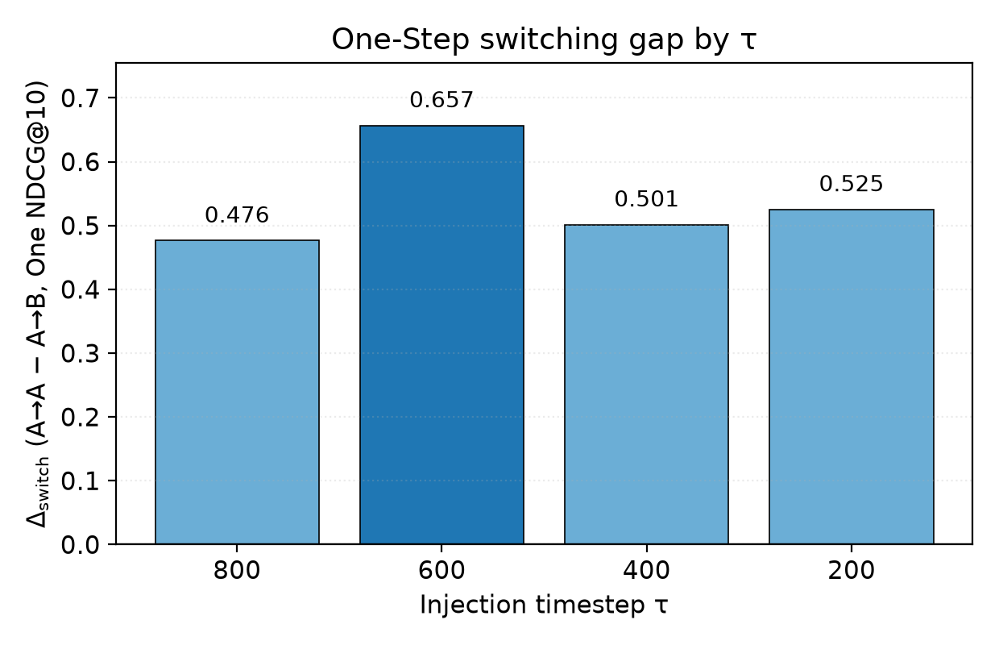

# FMNIST split cross-injection — Gradient proximity (Phase 3, ckpt 46k)

**Scope:** Model A/B class-split unconditional diffusion; cross-injection at τ = 800, 600, 400, 200; mid-block random-projected gradient neighborhoods (N=100 fixed noise IDs).  
**Source of truth:** `experiments/fmnist_split_cross_injection/full_ckpt46000_phase3_20261110/merged_report.json` (merged 2026-11-10).

**Notation (prose):** `x_τ^A` = Model-A latent immediately **before** the DDIM update at injection τ; τ′ = next scheduler index after τ (`tau_prime_after_one_step`). Display equations below use `$$ … $$` only.

---

## 1. Research Question

When we denoise the same intermediate state `x_τ^A` (reached with Model A) but apply Model B instead of A for subsequent sampling, does the **gradient neighborhood** of each noise anchor—ranking of peers by projected mid-block sensitivity—remain aligned with the reference ranking computed at `x_τ^A` under Model A?

We expect **A→A One-Step** to preserve neighborhoods almost perfectly because a single DDIM step stays on the A manifold. **A→B One-Step** tests immediate cross-model sensitivity. **Full denoising** probes whether rank structure survives to the final image when gradients are evaluated at **t = 0** on the completed sample (a post-sampling probe, not the gradient of the last DDIM update).

---

## 2. Experimental Setup

| Setting | Value |
| -------- | ----- |
| Data | FashionMNIST 32×32 grayscale, unconditional |
| Model A classes | 0, 2, 3, 4, 6 (T-shirt/top, Pullover, Dress, Coat, Shirt) |
| Model B classes | 1, 5, 7, 8, 9 (Trouser, Sandal, Sneaker, Bag, Ankle boot) |
| Architecture | Shared `UNet2DModel` config: [64, 128, 256] channels, prediction type ε, DDPM linear schedule, 1000 train steps |
| Initialization | **Identical weights** at step 0: Model B loads `outputs/fmnist_split_shared/init_seed0` before split training (`configs/fmnist_split_training.yaml`, `training.seed: 0`) |
| Training | Separate fine-tuning on 30k images per split to **EMA step 46000** (runs `fmnist_splitA_seed0_*`, `fmnist_splitB_seed0_*`) |
| Sampling | DDIM, η = 0, 1000 timesteps; injection at scheduler-listed τ |
| Noise anchors | Fixed pool IDs **0–99** (`fixed_noise_1000.pt`) |
| Injection τ | 800, 600, 400, 200 (τ=400 reused from Phase 2 symlink) |
| Gradients | **Mid block only**; K = 32 random projections, `projection_seed=20261109` |
| Metrics | Rank-graded NDCG@5/@10, top-k overlap, random baseline (50 draws, seed 20261109) |
| Classifier | CPU ONNX (`fashionmnist_tsilva`) on **full** outputs only (auxiliary) |

---

## 3. Experimental Design

**Figure 0.** Shared pipeline: fixed εi → Model A denoise until **pre-step** state at injection τ → `x_τ^A`.

**Reference (per anchor i):** Gradient features at timestep τ on (`x_τ^A`)i with Model A; pairwise cosines `S_ij` induce the reference neighbor ranking.

**One-Step cases** (from the same `x_τ^A`):

- **A→A:** one `ddim_one_step` with Model A at τ.
- **A→B:** one step with Model B at τ.

Gradients for One-Step are evaluated at the **next DDIM index** after injection τ (denoted τ′ in code: `tau_prime_after_one_step`)—not always τ − 1. Measured τ′ values: **799, 599, 399, 199** for injections 800, 600, 400, 200 (`align_injection_tau` in `sampling.py`).

**Full-Denoising cases:** From `x_τ^A`, run DDIM with Model A or B through **t = 0**. Gradient neighborhoods use **t = 0** on the final `x_0` image with the corresponding UNet. This is an **output sensitivity probe at the clean endpoint**, not the autograd signal inside the last DDIM `scheduler.step` call (`experiment_core.py`: `gradient_timestep: 0`, note *"x after DDIM step at t=0"*).

**Cross-model rule:** Reference and test similarities always use gradients from the **same** UNet when building each case’s `G_i`; we compare **test** rankings to the **reference** ranking, never raw cross-model gradient vectors.

---

## 4. Mathematical Definitions

### A. Random-projected gradient feature

$$
z_i = \operatorname{vec}(\epsilon_\theta(x_i,t)), \qquad
s_{i,k} = r_k^\top z_i, \qquad
g_{i,k} = \nabla_{\theta_{\mathrm{mid}}} s_{i,k}, \qquad
G_i = [g_{i,1};\ldots;g_{i,K}]
$$

Here K = 32, directions rk are fixed unit vectors in ℝ1024 (seed 20261109), and θmid are **mid block** parameters only (`gradient_proximity.py`).

### B. Gradient cosine similarity

$$
S_{ij} = \frac{G_i^\top G_j}{\lVert G_i\rVert_2 \lVert G_j\rVert_2}
$$

Within each case, `S_ij` ranks neighbors for anchor i (self excluded). Reference rankings come from Model A at `x_τ^A`; test rankings from the case-specific states and UNet.

### C. Rank-graded NDCG@k

$$
\mathrm{DCG}_k = \sum_{r=1}^{k} \frac{\mathrm{rel}(j_r)}{\log_2(r+1)}, \qquad
\mathrm{NDCG}_k = \frac{\mathrm{DCG}_k}{\mathrm{IDCG}_k}
$$

**Relevance:** For rank-grade mode, the reference’s top-k neighbors receive grades k, k − 1, …, 1; all others receive 0 (`rank_grade_relevance` in `neighborhood_metrics.py`). Test order is by test-case cosine `S_ij`.

### D. Top-k overlap

$$
\mathrm{Overlap}_k = \frac{|N_k^{\mathrm{ref}}(i) \cap N_k^{\mathrm{case}}(i)|}{k}
$$

### E. Switching gap (One-Step)

$$
\Delta_{\text{switch}}(\tau) = \mathrm{NDCG}_{A \to A}^{\text{one}}(\tau) - \mathrm{NDCG}_{A \to B}^{\text{one}}(\tau)
$$

Larger Δswitch means A→B preserves the reference ranking **less** than A→A at the same τ (descriptive contrast, not a causal decomposition of model swap effects).

---

## 5. Results

### Summary table (rank-graded NDCG@10 means)

| τ | A→A One | A→B One | Δ_switch | A→A Full | A→B Full |
| --- | ---: | ---: | ---: | ---: | ---: |
| 800 | 0.999 | 0.522 | **0.476** | 0.202 | 0.174 |
| 600 | 0.999 | 0.342 | **0.657** | 0.337 | 0.211 |
| 400 | 0.998 | 0.497 | **0.501** | 0.204 | 0.177 |
| 200 | 0.998 | 0.473 | **0.525** | 0.213 | 0.202 |

Random baseline (rank NDCG@10) is ≈ 0.082–0.084 per τ (reported inside each case).

**Figure 1.** One-Step mean rank NDCG@10 vs injection τ (800→200, toward completion). Shaded bars: **95% bootstrap CI** over 100 anchors (2000 resamples). A→A stays near 1.0; A→B sits far below A→A and above the random baseline. **Observation:** cross-model one-step disruption is large at every τ; the **lowest** A→B One value occurs at **τ=600** (0.342 mean), not at the earliest τ.

**Figure 2.** Δswitch peaks at **τ=600** (0.657); τ=800 is the **smallest** gap among the four (0.476). This is **not** monotonic in “early vs late” denoising.

**Figure 3.** Full-denoising rank NDCG@10 with the same Y-axis span as Figure 1. Final **t = 0** probes cluster well above random but **far below** One-Step A→A. A→A Full is highest at **τ=600** (0.337); A→A and A→B Full track each other closely (both ≲ 0.21 at τ=800/400/200).

**Figure 4 (supplementary).** One-Step rank NDCG@10 (left) and top-10 overlap (right) share the same τ ordering. **Observation:** when A→B NDCG drops (τ=600), overlap drops correspondingly (A→B top-10 mean 0.318 vs 0.482 at τ=800).

**Cosine-grade NDCG@10 (not plotted):** A→A One ≈ 0.94–1.0; A→B One ≈ 0.94–0.99—much higher than rank-grade—because cosine magnitudes compress relevance; rank-grade is the stricter neighborhood test emphasized here.

---

## 6. Secondary Validation

**Classifier** (predicted labels, not ground truth): fraction of samples assigned to split-defined class groups on **full** outputs.

| τ | A→A: Split-A % | A→B: Split-B % |
| --- | ---: | ---: |
| 800 | 79 | 92 |
| 600 | 98 | 95 |
| 400 | 78 | 95 |
| 200 | 83 | 49 |

These align loosely with B dominance on A→B at most τ, but **τ=200 A→B** does not show split-B majority (49%)—a reminder that classifier group fractions are a coarse check, not the primary metric.

**Sampling quality audit** (separate GPU 999→0 run, ckpt 46k): **Pure Model B** already yields **86% Bag** among 100 fixed noises; **A→B Full at τ=400** reaches **95% Bag**. That bias is **observed** in generated images; it does not by itself explain gradient NDCG, but it cautions against interpreting Bag-heavy A→B grids as a pipeline bug.

**Figure 5.** A→A vs A→B full outputs (τ=400, noise IDs 0–99); copied from Phase 2 plots (read-only source).

---

## 7. Discussion and Conclusion

### Key findings

1. **One-Step A→A** rank NDCG@10 ≈ 0.998–0.999 at all τ: the reference mid-block neighborhood is stable under a single in-model DDIM step.
2. **One-Step A→B** stays well below A→A (0.34–0.52) with Δswitch **largest at τ=600** (0.657), not at τ=800 or τ=200.
3. **Full t = 0 probes** show rank NDCG ≈ 0.17–0.34, only modestly above random (≈ 0.083): endpoint sensitivity neighborhoods **do not** mirror the nearly perfect One-Step A→A structure.

### Hypothesis evaluation

If one hypothesized that **later** injection (smaller τ, closer to `x_0`) always maximizes model-switch disruption, Phase 3 does **not** support a simple monotonic rule: the worst One-Step A→B preservation is at **τ=600**, and τ=800 shows the **smallest** switching gap. **Interpretation (not measured directly):** mid-training-time dynamics under DDIM may interact non-monotonically with split specialization.

### Limitations

Two split-trained models, single checkpoint, 100 anchors, FashionMNIST resolution, mid-block-only features, Full metric at **fixed t = 0** rather than in-step Jacobians, and strong **Bag / split-B** classifier skew on Model B and cross paths.

### Next steps

1. Repeat with cosine-grade vs rank-grade side-by-side dashboards (cosine already in `tau_report.json`).
2. Optional B→B and pure-A/B baselines at matched τ to separate injection from pure model bias.
3. Larger noise panels or held-out IDs to tighten bootstrap uncertainty on τ-dependent gaps.

---

*Raw assets:* `full_ckpt46000_phase3_20261110/tau_<τ>/tau_report.json`, per-τ `plots/`, `classifier_*.json`. Phase 2 τ=400 directory unchanged (symlink). No training reruns.*
