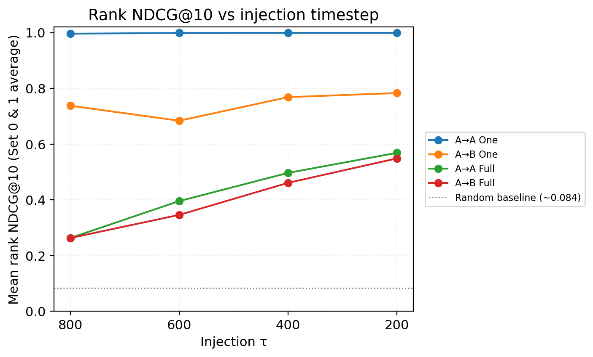
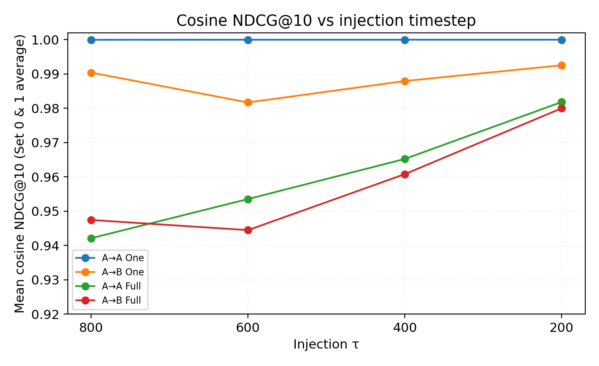
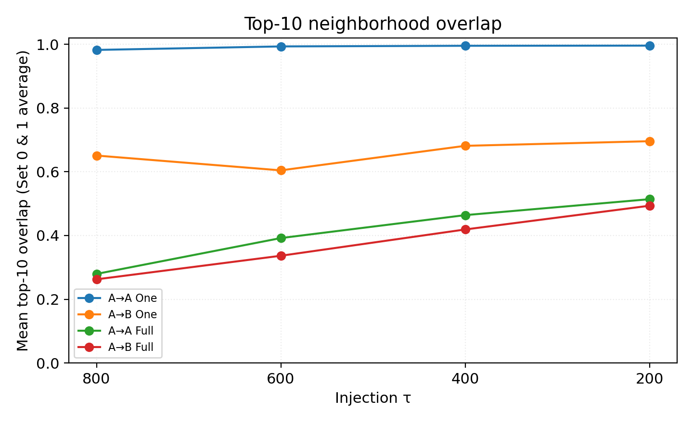
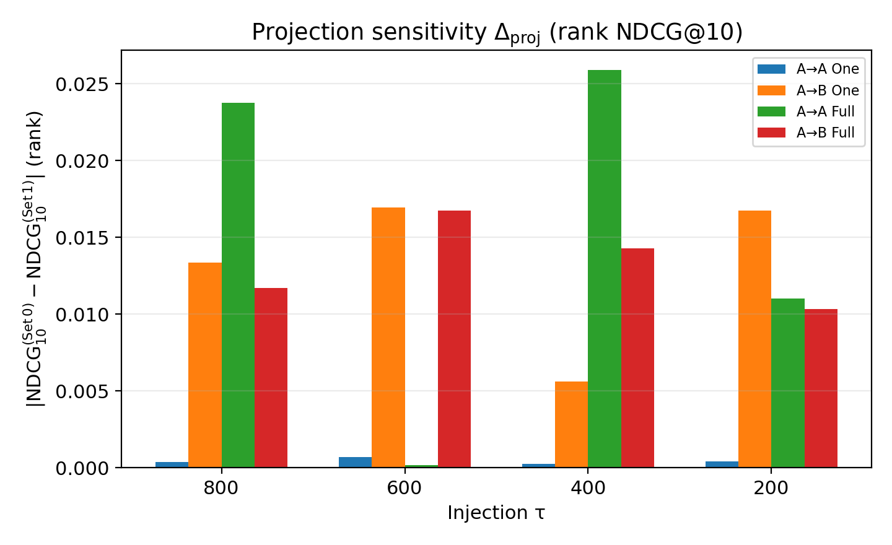
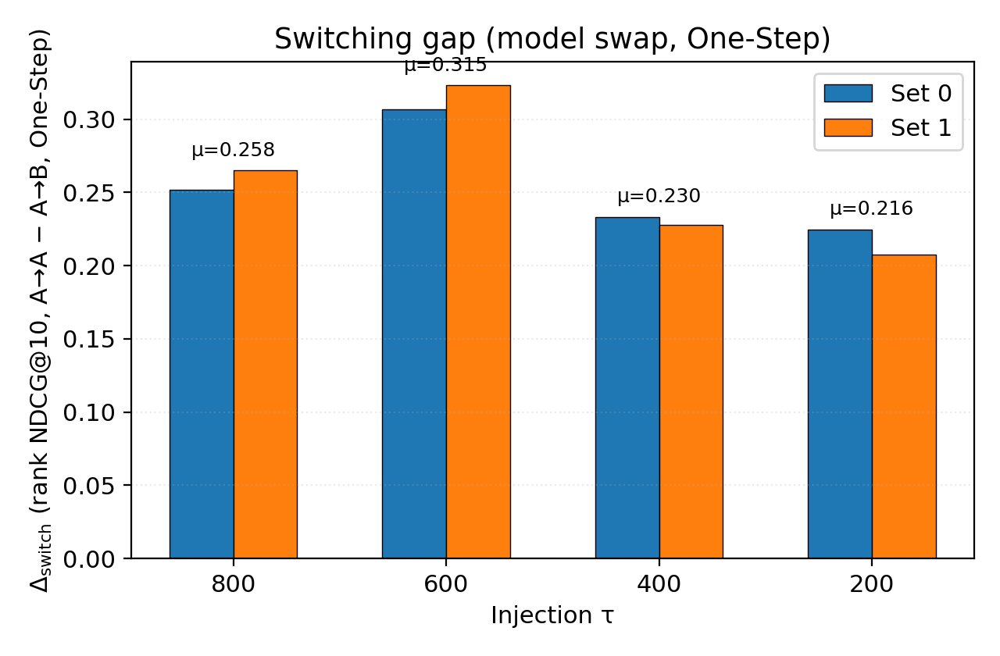

# FMNIST split cross-injection — Gradient proximity (corrected sampling, ckpt 46k)

**Scope:** Model A/B class-split unconditional diffusion; shared `x_τ^A` from Model A; injection τ ∈ {800, 600, 400, 200}; mid-block random-projected gradient neighborhoods (N = 100 noise IDs 0–99).  
**Primary source:** `experiments/fmnist_split_cross_injection/full_ckpt46000_phase4_proj2_20261110/merged_report.json` (`validation: ok`). Set 0 (seed 20261109) matches Corrected Phase 3.

**Notation:** `x_τ^A` = Model-A latent immediately **before** the DDIM update at injection τ; τ′ = next scheduler index (799, 599, 399, 199). Display math uses `$$ … $$`.

---

## 1. Overview

We ask whether **gradient neighborhoods**—peer rankings induced by projected mid-block sensitivities—stay aligned with a reference computed at `x_τ^A` under Model A when subsequent denoising uses Model B.

| Case | Model at probe | Gradient timestep |
| --- | --- | --- |
| Reference | A | τ |
| A→A One-Step | A | τ′ |
| A→B One-Step | B | τ′ |
| A→A Full | A | **t = 0** on final image |
| A→B Full | B | **t = 0** on final image |

Phase 4 repeats all gradient metrics under **two projection sets** (seeds 20261109 / 20261110, K = 32 each) with shared DDIM latents (`sampling_shared/`). Cross-set agreement is reported as **exploratory reproducibility across two projection seeds** (n = 2); it is not a general stability certificate.

---

## 2. Experimental Setup

| Setting | Value |
| -------- | ----- |
| Data | FashionMNIST 32×32 grayscale, unconditional |
| Model A classes | 0, 2, 3, 4, 6 |
| Model B classes | 1, 5, 7, 8, 9 |
| Split size | 30,000 images per model |
| Init / training | Same initial weights; independent fine-tuning to **EMA step 46000** |
| Sampling | DDIM, η = 0, 1000 train timesteps |
| Noise anchors | Fixed IDs **0–99** (`fixed_noise_1000.pt`) |
| Injection τ | 800, 600, 400, 200 |
| Projections | **Set 0:** seed 20261109; **Set 1:** seed 20261110; K = 32 directions each |
| Gradients | **U-Net mid block only**; weights frozen except mid block for `autograd.grad` |
| Metrics | Rank- and cosine-grade NDCG@5/@10, top-k overlap, random baseline (50 permutations, seed 20261109) |
| Classifier | ONNX on **full** outputs only (predicted labels; auxiliary) |

**Sampling validation (post-fix):** Independent DDIM trajectory max diff = **0**; τ-wise step counts match; A→A and A→B One-Step share identical `x_τ^A`; model `state_dict` unchanged across cases.

---

## 3. Gradient Proximity

Let εθ(x, t) be the U-Net noise prediction. With output dimension 1024 (= 1×32×32 channels flattened):

$$
z_\theta(x,t)=\mathrm{vec}(\epsilon_\theta(x,t)), \qquad
s_k=r_k^\top z_\theta(x,t), \qquad
g_k=\nabla_{\theta_{\mathrm{mid}}}s_k, \qquad
G_i=\mathrm{concat}(g_1,\ldots,g_{32})
$$

Pairwise similarities:

$$
S_{ij}=\frac{G_i^\top G_j}{\|G_i\|_2\|G_j\|_2}
$$

**Implementation (`gradient_proximity.py`):** Only mid-block parameters receive `requires_grad`; scalars sk use `torch.autograd.grad` without weight updates. Concatenated dimension **|Gi| = 88,244,224**.

### NDCG@k

$$
\mathrm{DCG}_k=\sum_{r=1}^{k}\frac{\mathrm{rel}(j_r)}{\log_2(r+1)}, \qquad
\mathrm{NDCG}_k=\frac{\mathrm{DCG}_k}{\mathrm{IDCG}_k}
$$

- **Rank-grade:** Reference top-k neighbors get grades k, k−1, …, 1; others 0.
- **Cosine-grade:** Relevance of neighbor j is **(Srefij + 1) / 2**.

### Two distinct gap metrics

**Projection sensitivity** (seed disagreement, same case & τ):

$$
\Delta_{\mathrm{proj}}=\left|\mathrm{NDCG}^{(\mathrm{Set}\,0)}-\mathrm{NDCG}^{(\mathrm{Set}\,1)}\right|
$$

Optional signed form: $\Delta_{01}=\mathrm{NDCG}^{(\mathrm{Set}\,1)}-\mathrm{NDCG}^{(\mathrm{Set}\,0)}$.

**Switching gap** (model swap, same projection set):

$$
\Delta_{\mathrm{switch}}=\mathrm{NDCG}_{A\to A}-\mathrm{NDCG}_{A\to B}
$$

Do not interchange $\Delta_{\mathrm{proj}}$ and $\Delta_{\mathrm{switch}}$; Figure 4 vs Figure 5 plot these separately.

### Aggregation across two projection sets

For each metric value $x_0$ (Set 0) and $x_1$ (Set 1):

$$
\mu=\frac{x_0+x_1}{2}, \qquad
s=\sqrt{\frac{(x_0-\mu)^2+(x_1-\mu)^2}{n-1}}, \; n=2
$$

**Statistics check:** All §5.3 table values $(\mu,s)$ are recomputed from per-set `tau_report.json` (96 cells = 4 cases × 4 τ × 6 metrics). Rank/cosine NDCG@10 and top-10 overlap means/stds additionally match `merged_report.json` (`validate_phase4_report_data.py`). NDCG@5 and top-5 overlap are not stored in `merged_report.json`; only the per-set source + $(\mu,s)$ recomputation applies.

---

## 4. Experimental Design

**Figure 0.** Shared pipeline: fixed εi → Model A DDIM to pre-step state at τ → `x_τ^A` → reference / One-Step / Full branches.

Phase 4: one `sampling_shared/` tree per τ; gradient passes differ only by projection bank.

---

## 5. Results

Random baseline (rank NDCG@10) ≈ **0.083–0.084** per τ.

### 5.1 Summary — rank NDCG@10 (μ across projection sets)

| τ | A→A One μ ± *s* | A→B One μ ± *s* | A→A Full μ ± *s* | A→B Full μ ± *s* |
| ---: | ---: | ---: | ---: | ---: |
| 800 | 0.9961 ± 0.0003 | 0.7377 ± 0.0095 | 0.2634 ± 0.0168 | 0.2632 ± 0.0083 |
| 600 | 0.9989 ± 0.0005 | **0.6839 ± 0.0120** | 0.3957 ± 0.0001 | 0.3461 ± 0.0118 |
| 400 | 0.9990 ± 0.0002 | 0.7686 ± 0.0040 | 0.4968 ± 0.0183 | 0.4611 ± 0.0101 |
| 200 | 0.9991 ± 0.0003 | 0.7832 ± 0.0118 | 0.5687 ± 0.0078 | 0.5489 ± 0.0073 |

**A→B One-Step** rank NDCG@10 is **lowest at τ = 600** (μ = 0.6839).

### 5.2 Figures

**Figure 1.** Rank NDCG@10 vs τ (μ of Set 0 and Set 1). Four cases; random baseline dotted.

**Figure 2.** Cosine NDCG@10 vs τ (set mean). Cosine-grade compresses switching effects vs rank-grade.

**Figure 3.** Top-10 neighborhood overlap vs τ (set mean).

**Figure 4.** $\Delta_{\mathrm{proj}}$ for **rank NDCG@10**: $|\mathrm{Set}\,0-\mathrm{Set}\,1|$ per case and τ. This is **not** neighborhood preservation under model switching.

**Figure 5.** $\Delta_{\mathrm{switch}}$ (One-Step rank NDCG@10, A→A − A→B) per projection set. Largest **μ** at **τ = 600** (0.315).

**Supplementary.** A→A vs A→B full outputs (τ = 400, corrected Phase 3 plots).

### 5.3 Full metric tables (Set 0, Set 1, μ, *s*)

Tables list every Case × τ combination. *s* is the sample standard deviation with **n = 2** projection sets (ddof = 1).

#### Rank NDCG@5

| Case | τ | Set 0 | Set 1 | μ | *s* |
| --- | ---: | ---: | ---: | ---: | ---: |
| A→A One | 800 | 0.9940 | 0.9909 | 0.9925 | 0.0022 |
| A→A One | 600 | 0.9990 | 0.9988 | 0.9989 | 0.0001 |
| A→A One | 400 | 0.9965 | 0.9983 | 0.9974 | 0.0013 |
| A→A One | 200 | 0.9985 | 0.9971 | 0.9978 | 0.0010 |
| A→B One | 800 | 0.6575 | 0.6479 | 0.6527 | 0.0068 |
| A→B One | 600 | 0.5966 | 0.5881 | 0.5923 | 0.0060 |
| A→B One | 400 | 0.6694 | 0.6892 | 0.6793 | 0.0140 |
| A→B One | 200 | 0.6742 | 0.6905 | 0.6824 | 0.0115 |
| A→A Full | 800 | 0.1524 | 0.1840 | 0.1682 | 0.0223 |
| A→A Full | 600 | 0.2749 | 0.2652 | 0.2701 | 0.0068 |
| A→A Full | 400 | 0.3585 | 0.3909 | 0.3747 | 0.0229 |
| A→A Full | 200 | 0.4564 | 0.4778 | 0.4671 | 0.0151 |
| A→B Full | 800 | 0.1789 | 0.1694 | 0.1741 | 0.0067 |
| A→B Full | 600 | 0.2462 | 0.2242 | 0.2352 | 0.0156 |
| A→B Full | 400 | 0.3422 | 0.3589 | 0.3506 | 0.0119 |
| A→B Full | 200 | 0.4549 | 0.4579 | 0.4564 | 0.0021 |

#### Rank NDCG@10

| Case | τ | Set 0 | Set 1 | μ | *s* |
| --- | ---: | ---: | ---: | ---: | ---: |
| A→A One | 800 | 0.9963 | 0.9960 | 0.9961 | 0.0003 |
| A→A One | 600 | 0.9993 | 0.9986 | 0.9989 | 0.0005 |
| A→A One | 400 | 0.9989 | 0.9992 | 0.9990 | 0.0002 |
| A→A One | 200 | 0.9993 | 0.9989 | 0.9991 | 0.0003 |
| A→B One | 800 | 0.7444 | 0.7311 | 0.7377 | 0.0095 |
| A→B One | 600 | 0.6924 | 0.6755 | 0.6839 | 0.0120 |
| A→B One | 400 | 0.7658 | 0.7714 | 0.7686 | 0.0040 |
| A→B One | 200 | 0.7748 | 0.7915 | 0.7832 | 0.0118 |
| A→A Full | 800 | 0.2515 | 0.2752 | 0.2634 | 0.0168 |
| A→A Full | 600 | 0.3957 | 0.3956 | 0.3957 | 0.0001 |
| A→A Full | 400 | 0.4839 | 0.5097 | 0.4968 | 0.0183 |
| A→A Full | 200 | 0.5632 | 0.5742 | 0.5687 | 0.0078 |
| A→B Full | 800 | 0.2691 | 0.2574 | 0.2632 | 0.0083 |
| A→B Full | 600 | 0.3545 | 0.3377 | 0.3461 | 0.0118 |
| A→B Full | 400 | 0.4682 | 0.4539 | 0.4611 | 0.0101 |
| A→B Full | 200 | 0.5540 | 0.5437 | 0.5489 | 0.0073 |

#### Cosine NDCG@5

| Case | τ | Set 0 | Set 1 | μ | *s* |
| --- | ---: | ---: | ---: | ---: | ---: |
| A→A One | 800 | 1.0000 | 1.0000 | 1.0000 | 0.0000 |
| A→A One | 600 | 1.0000 | 1.0000 | 1.0000 | 0.0000 |
| A→A One | 400 | 1.0000 | 1.0000 | 1.0000 | 0.0000 |
| A→A One | 200 | 1.0000 | 1.0000 | 1.0000 | 0.0000 |
| A→B One | 800 | 0.9904 | 0.9896 | 0.9900 | 0.0006 |
| A→B One | 600 | 0.9798 | 0.9793 | 0.9796 | 0.0004 |
| A→B One | 400 | 0.9848 | 0.9854 | 0.9851 | 0.0005 |
| A→B One | 200 | 0.9905 | 0.9904 | 0.9905 | 0.0000 |
| A→A Full | 800 | 0.9372 | 0.9376 | 0.9374 | 0.0003 |
| A→A Full | 600 | 0.9483 | 0.9502 | 0.9493 | 0.0013 |
| A→A Full | 400 | 0.9568 | 0.9623 | 0.9595 | 0.0039 |
| A→A Full | 200 | 0.9775 | 0.9794 | 0.9785 | 0.0014 |
| A→B Full | 800 | 0.9448 | 0.9425 | 0.9437 | 0.0016 |
| A→B Full | 600 | 0.9413 | 0.9385 | 0.9399 | 0.0020 |
| A→B Full | 400 | 0.9543 | 0.9547 | 0.9545 | 0.0003 |
| A→B Full | 200 | 0.9764 | 0.9757 | 0.9761 | 0.0005 |

#### Cosine NDCG@10

| Case | τ | Set 0 | Set 1 | μ | *s* |
| --- | ---: | ---: | ---: | ---: | ---: |
| A→A One | 800 | 1.0000 | 1.0000 | 1.0000 | 0.0000 |
| A→A One | 600 | 1.0000 | 1.0000 | 1.0000 | 0.0000 |
| A→A One | 400 | 1.0000 | 1.0000 | 1.0000 | 0.0000 |
| A→A One | 200 | 1.0000 | 1.0000 | 1.0000 | 0.0000 |
| A→B One | 800 | 0.9908 | 0.9900 | 0.9904 | 0.0005 |
| A→B One | 600 | 0.9821 | 0.9813 | 0.9817 | 0.0006 |
| A→B One | 400 | 0.9878 | 0.9881 | 0.9880 | 0.0003 |
| A→B One | 200 | 0.9924 | 0.9928 | 0.9926 | 0.0003 |
| A→A Full | 800 | 0.9420 | 0.9422 | 0.9421 | 0.0002 |
| A→A Full | 600 | 0.9527 | 0.9543 | 0.9535 | 0.0011 |
| A→A Full | 400 | 0.9633 | 0.9672 | 0.9652 | 0.0027 |
| A→A Full | 200 | 0.9813 | 0.9824 | 0.9818 | 0.0007 |
| A→B Full | 800 | 0.9476 | 0.9473 | 0.9474 | 0.0002 |
| A→B Full | 600 | 0.9455 | 0.9434 | 0.9445 | 0.0015 |
| A→B Full | 400 | 0.9616 | 0.9600 | 0.9608 | 0.0011 |
| A→B Full | 200 | 0.9802 | 0.9798 | 0.9800 | 0.0003 |

#### Top-5 overlap

| Case | τ | Set 0 | Set 1 | μ | *s* |
| --- | ---: | ---: | ---: | ---: | ---: |
| A→A One | 800 | 0.978 | 0.980 | 0.979 | 0.001 |
| A→A One | 600 | 0.998 | 1.000 | 0.999 | 0.001 |
| A→A One | 400 | 0.988 | 0.994 | 0.991 | 0.004 |
| A→A One | 200 | 0.996 | 0.992 | 0.994 | 0.003 |
| A→B One | 800 | 0.578 | 0.562 | 0.570 | 0.011 |
| A→B One | 600 | 0.538 | 0.520 | 0.529 | 0.013 |
| A→B One | 400 | 0.626 | 0.622 | 0.624 | 0.003 |
| A→B One | 200 | 0.612 | 0.618 | 0.615 | 0.004 |
| A→A Full | 800 | 0.174 | 0.188 | 0.181 | 0.010 |
| A→A Full | 600 | 0.292 | 0.294 | 0.293 | 0.001 |
| A→A Full | 400 | 0.336 | 0.394 | 0.365 | 0.041 |
| A→A Full | 200 | 0.418 | 0.448 | 0.433 | 0.021 |
| A→B Full | 800 | 0.188 | 0.172 | 0.180 | 0.011 |
| A→B Full | 600 | 0.262 | 0.242 | 0.252 | 0.014 |
| A→B Full | 400 | 0.334 | 0.354 | 0.344 | 0.014 |
| A→B Full | 200 | 0.408 | 0.396 | 0.402 | 0.008 |

#### Top-10 overlap

| Case | τ | Set 0 | Set 1 | μ | *s* |
| --- | ---: | ---: | ---: | ---: | ---: |
| A→A One | 800 | 0.980 | 0.985 | 0.983 | 0.004 |
| A→A One | 600 | 0.996 | 0.991 | 0.994 | 0.004 |
| A→A One | 400 | 0.995 | 0.996 | 0.996 | 0.001 |
| A→A One | 200 | 0.996 | 0.996 | 0.996 | 0.000 |
| A→B One | 800 | 0.652 | 0.650 | 0.651 | 0.001 |
| A→B One | 600 | 0.617 | 0.592 | 0.605 | 0.018 |
| A→B One | 400 | 0.680 | 0.683 | 0.681 | 0.002 |
| A→B One | 200 | 0.691 | 0.701 | 0.696 | 0.007 |
| A→A Full | 800 | 0.275 | 0.284 | 0.279 | 0.006 |
| A→A Full | 600 | 0.386 | 0.398 | 0.392 | 0.008 |
| A→A Full | 400 | 0.451 | 0.477 | 0.464 | 0.018 |
| A→A Full | 200 | 0.514 | 0.514 | 0.514 | 0.000 |
| A→B Full | 800 | 0.266 | 0.259 | 0.263 | 0.005 |
| A→B Full | 600 | 0.340 | 0.333 | 0.336 | 0.005 |
| A→B Full | 400 | 0.429 | 0.409 | 0.419 | 0.014 |
| A→B Full | 200 | 0.505 | 0.482 | 0.493 | 0.016 |

#### Projection sensitivity Δ_proj (|Set 0 − Set 1|)

Absolute difference between projection sets for the same case and τ. Columns: rank NDCG@10, cosine NDCG@10, top-10 overlap.

| Case | τ | Δ_proj rank@10 | Δ_proj cos@10 | Δ_proj top-10 |
| --- | ---: | ---: | ---: | ---: |
| A→A One | 800 | 0.0004 | 0.000013 | 0.0050 |
| A→A One | 600 | 0.0007 | 0.000001 | 0.0050 |
| A→A One | 400 | 0.0003 | 0.000000 | 0.0010 |
| A→A One | 200 | 0.0004 | 0.000000 | 0.0000 |
| A→B One | 800 | 0.0134 | 0.000762 | 0.0020 |
| A→B One | 600 | 0.0169 | 0.000867 | 0.0250 |
| A→B One | 400 | 0.0056 | 0.000375 | 0.0030 |
| A→B One | 200 | 0.0167 | 0.000404 | 0.0100 |
| A→A Full | 800 | 0.0237 | 0.000237 | 0.0090 |
| A→A Full | 600 | 0.0001 | 0.001625 | 0.0120 |
| A→A Full | 400 | 0.0259 | 0.003870 | 0.0260 |
| A→A Full | 200 | 0.0110 | 0.001033 | 0.0000 |
| A→B Full | 800 | 0.0117 | 0.000342 | 0.0070 |
| A→B Full | 600 | 0.0167 | 0.002066 | 0.0070 |
| A→B Full | 400 | 0.0143 | 0.001540 | 0.0200 |
| A→B Full | 200 | 0.0103 | 0.000408 | 0.0230 |

#### Switching gap Δ_switch (rank NDCG@10, A→A − A→B)

| τ | One-Step Set 0 | One-Step Set 1 | One-Step μ | Full Set 0 | Full Set 1 | Full μ |
| ---: | ---: | ---: | ---: | ---: | ---: | ---: |
| 800 | 0.2519 | 0.2649 | 0.2584 | -0.0176 | 0.0179 | 0.0001 |
| 600 | 0.3069 | 0.3231 | 0.3150 | 0.0413 | 0.0579 | 0.0496 |
| 400 | 0.2331 | 0.2278 | 0.2305 | 0.0156 | 0.0558 | 0.0357 |
| 200 | 0.2245 | 0.2073 | 0.2159 | 0.0092 | 0.0305 | 0.0199 |
---

## 6. Projection reproducibility

| Set | Projection seed | Vectors |
| ---: | ---: | ---: |
| 0 | 20261109 | 32 |
| 1 | 20261110 | 32 |

Set 0 matches Corrected Phase 3 (same seed); merge reports `validation_warnings_phase3_parity: []`.

### 6.1 Maximum $\Delta_{\mathrm{proj}}$ (from Phase 4 JSON, recomputed)

| Quantity | Scope | Max value | τ | Case / metric |
| --- | --- | ---: | ---: | --- |
| Rank NDCG@10 | A→B One-Step only | **0.0169** | 600 | A→B One |
| Rank NDCG@10 | **All cases** | **0.0259** | 400 | A→A Full |
| Cosine NDCG@10 | All cases | 0.003870 | 400 | A→A Full |
| Top-10 overlap | All cases | 0.0260 | 400 | A→A Full |

**Do not** summarize projection sensitivity as a single “~0.013” without specifying metric and case. A→A One-Step rank @10 has $|\Delta_{\mathrm{proj}}|\lesssim 7\times 10^{-4}$ at all τ; larger rank $\Delta_{\mathrm{proj}}$ appears on **Full** paths and some **A→B** One-Step τ values.

Interpretation: **exploratory reproducibility across two projection seeds**—qualitative patterns align, but n = 2 does not establish general projection stability.

---

## 7. Discussion

### One-Step

- **A→A** preserves reference neighborhoods: rank NDCG@10 μ ≈ **0.996–0.999** at all τ.
- **A→B** shows materially lower rank NDCG (μ ≈ **0.684–0.783**), still above random (~0.083).
- **τ = 600** gives the **minimum A→B One-Step** rank NDCG@10 (μ = **0.6839**, Set 0 = 0.6924, Set 1 = 0.6755).

### Full denoising

- Rank NDCG@10 at t = 0 is **much lower** than One-Step A→A (e.g. μ ≈ 0.26–0.57 vs ≈ 1.0).
- Full rank NDCG **increases** as injection moves toward completion (τ 800 → 200): A→A Full **0.263 → 0.569**, A→B Full **0.263 → 0.549**.
- **A→A vs A→B Full** differs from One-Step: at τ = 800, Full rank μ is nearly tied (~0.263); at τ = 600, A→A Full exceeds A→B Full by ~0.05 (rank); Full $\Delta_{\mathrm{switch}}$ can be **negative in one set** at τ = 800 (Set 0: −0.0176), so signed per-set gaps matter.

### Projection reproducibility

- Main qualitative pattern (high A→A One-Step, lower A→B One-Step, τ = 600 dip) appears in **both** seeds.
- **Rank** metrics show larger $\Delta_{\mathrm{proj}}$ than **cosine** on several Full / A→B cells (see projection table in §5.3).
- This is **not** a proof of global projection stability—only a check with **two** banks.

### Switching effect ($\Delta_{\mathrm{switch}}$, not $\Delta_{\mathrm{proj}}$)

One-Step rank $\Delta_{\mathrm{switch}}$ (μ): **0.315** (τ = 600) > 0.258 (800) > 0.231 (400) > 0.216 (200). **Across projection sets**, the One-Step switching gap (same metric, rank NDCG@10, A→A − A→B) differs by at most **0.0172** (τ = 200; Set 0 = 0.2245, Set 1 = 0.2073). At τ = 800 the set-to-set difference is **0.0130** (0.2649 − 0.2519). This is **not** projection sensitivity $\Delta_{\mathrm{proj}}$ on a single case; see the switching table in §5.3 vs the $\Delta_{\mathrm{proj}}$ table above it.

**Classifier (full, Set 0, mean P(split-A group)):** A→A ≈ 67%; A→B ≈ 18% / 22% / 34% / 50% at τ 800 / 600 / 400 / 200 (auxiliary).

---

## 8. Limitations

- **Projection sets n = 2** (exploratory reproducibility only).
- 100 fixed noise IDs; FashionMNIST 32×32; small unconditional U-Net.
- Mid-block gradient features only; Full probe at **t = 0**, not in-step DDIM Jacobians.
- Classifier uses predicted labels.
- Phase 4 ran with `--no-plots` in-run; report figures rebuilt from JSON via `build_corrected_phase4_report_figures.py`.

---

## 9. Conclusion

After corrected DDIM-until-τ sampling, cross-injection gradient neighborhoods are measurable and reproducible across two projection seeds. **One-Step A→A** nearly preserves rank neighborhoods; **One-Step A→B** shows partial preservation with a **τ = 600** minimum. **Full t = 0** probes align more weakly but improve at later injection. **$\Delta_{\mathrm{switch}}$** (model swap) and **$\Delta_{\mathrm{proj}}$** (seed swap) answer different questions and must be read from separate tables and Figures 4–5.

---

*Raw assets:* `full_ckpt46000_phase4_proj2_20261110/` (`merged_report.json`, `tau_*/projection_set_*/tau_report.json`, `sampling_shared/`). Corrected Phase 3 parity for Set 0. No training reruns.*

*Figure build:* `build_corrected_phase4_report_figures.py`. *Audit (read-only):* `validate_phase4_report_data.py`, `audit_report_figures.py` — last run 2026-11-10, merged cross-check 0 failures, Fig 1–5 present and consistent with JSON.*
