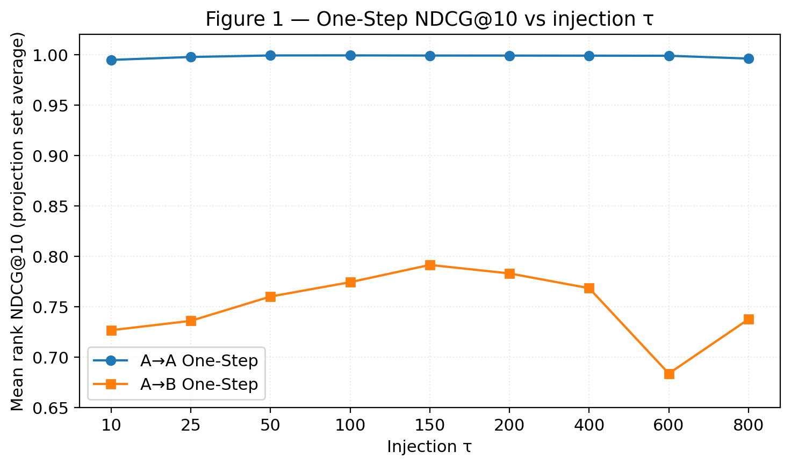
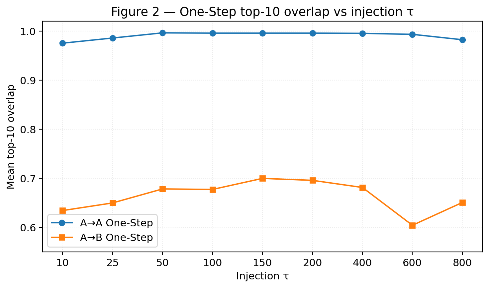
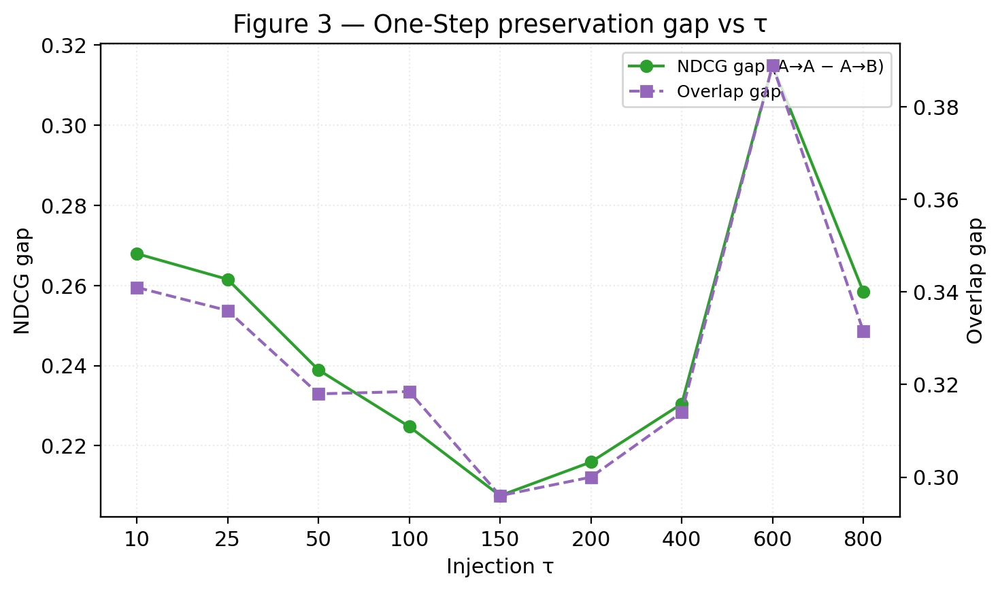
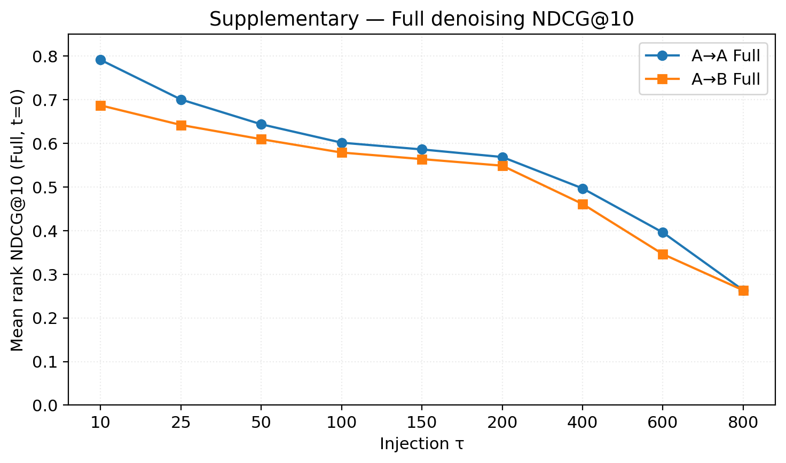
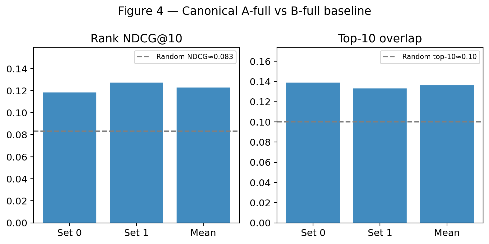
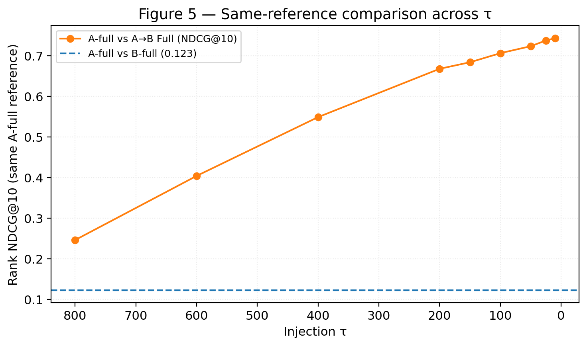

# FMNIST split cross-injection — Follow-up experiments (late-τ extension & canonical A/B baseline)

## Abstract

We extend the Phase 4 cross-injection gradient-proximity study in two directions. **Experiment 1 (Small Timestep Extension)** adds injection timesteps τ ∈ {150, 100, 50, 25, 10} to the original {800, 600, 400, 200}, yielding a nine-point curve at EMA checkpoint 46k with 100 fixed noise anchors and two projection sets (K = 32). **One-Step** switching gaps do **not** shrink monotonically toward τ = 10; among the **nine measured injection τ values**, the largest One-Step disruption occurs at **τ = 600** (NDCG gap ≈ 0.315). **Experiment 2 (Canonical A-full vs B-full baseline)** compares independently denoised Model A and Model B final gradient neighborhoods using the **same** rank-grade NDCG@10 and top-10 overlap definitions. After invalidating legacy audit latents, the **official** structural baseline is rank NDCG@10 **0.1228** (top-10 overlap **0.1360**, projection-set mean). Re-analyzing cross-injection **A→B Full** under a **common A-full reference** shows higher endpoint alignment when Model A’s trajectory is shared longer before switching—not contradictory with Experiment 1’s τ-local reference.

**Prior report (unchanged):** [2026-11-10_cross-injection-gradient-proximity.md](2026-11-10_cross-injection-gradient-proximity.md) (Phase 4 only).

**Notation:** `x_τ^A` = Model-A latent immediately **before** the DDIM update at injection τ; τ′ = next scheduler index. Display math uses `$$ … $$` where helpful.

---

## Part I — Small Timestep Extension (Experiment 1)

### 1. Research motivation

Phase 4 measured whether gradient neighborhoods stay aligned when denoising continues with Model B instead of Model A from a **shared** intermediate state. A natural follow-up is whether **late** injection (small τ, near t = 0) reduces cross-model neighborhood disruption—i.e., whether switching after most denoising steps under Model A makes Model B’s One-Step gradients more compatible with the reference ranking at `x_τ^A`.

**Research question (Experiment 1):** *Does cross-model neighborhood disruption diminish near the end of denoising?*

We added τ ∈ {150, 100, 50, 25, 10} under the **same** protocol as Phase 4 and merged with existing τ points for analysis.

### 2. Experimental design

| Setting | Value |
| --- | --- |
| Data | FashionMNIST 32×32, unconditional |
| Models | Class-split A / B (same training story as Phase 4; EMA **46,000**) |
| Noise anchors | IDs **0–99** (`fixed_noise_1000.pt`) |
| Sampling | DDIM, η = 0, 1000 inference steps |
| Injection τ | **10, 25, 50, 100, 150**, 200, 400, 600, 800 |
| Projections | Set 0: seed 20261109; Set 1: seed 20261110; **K = 32** |
| Gradients | U-Net **mid block** only (frozen elsewhere) |
| Metrics | Rank-grade NDCG@10, top-10 overlap (plus cosine-grade & random baselines in JSON) |

**Reference (Experiment 1):** Model A gradients at **(x_τ^A)i, timestep τ** — identical to Phase 4.

| Case | Continuation | Gradient probe time |
| --- | --- | --- |
| A→A One-Step | Model A, one DDIM step from x_τ^A | τ′ |
| A→B One-Step | Model B, one DDIM step from x_τ^A | τ′ |
| A→A Full | Model A, denoise x_τ^A → t = 0 | **t = 0** on final latent |
| A→B Full | Model B, denoise x_τ^A → t = 0 | **t = 0** on final latent |

**One-Step vs Full (important):** One-Step probes neighborhoods **immediately after the first post-injection update** at τ′ on almost-the-same latent geometry. Full probes neighborhoods at **t = 0** after the entire remaining trajectory. Full metrics therefore mix **long-horizon denoising drift** with switching effects; even A→A Full often loses rank NDCG relative to the τ-reference because the latent and probe time both change. One-Step isolates **local** switching at the injection point; Full describes **endpoint** structure.

**Data sources:** Phase 4 (`full_ckpt46000_phase4_proj2_20261110/`); new latencies in `full_ckpt46000_late_tau_parallel_test_20261124/`; merged tables in `experiments/.../analysis/late_tau_extension_20261124/` (18/18 `tau_report.json`; validation documented there).

### 3. Results — One-Step neighborhood preservation

Table values are **arithmetic means** over projection sets 0 and 1 (verified against `merged_tau_summary.csv`).

**Rank NDCG@10 (One-Step)**

| τ | A→A | A→B | Gap (A→A − A→B) |
| ---: | ---: | ---: | ---: |
| 10 | 0.9948 | 0.7269 | 0.2679 |
| 25 | 0.9977 | 0.7362 | 0.2615 |
| 50 | 0.9992 | 0.7603 | 0.2389 |
| 100 | 0.9993 | 0.7745 | 0.2248 |
| 150 | 0.9991 | 0.7916 | 0.2075 |
| 200 | 0.9991 | 0.7832 | 0.2159 |
| 400 | 0.9990 | 0.7686 | 0.2305 |
| 600 | 0.9989 | 0.6839 | **0.3150** |
| 800 | 0.9961 | 0.7377 | 0.2584 |

**Top-10 overlap (One-Step)**

| τ | A→A | A→B | Gap |
| ---: | ---: | ---: | ---: |
| 10 | 0.9755 | 0.6345 | 0.3410 |
| 25 | 0.9860 | 0.6500 | 0.3360 |
| 50 | 0.9965 | 0.6785 | 0.3180 |
| 100 | 0.9960 | 0.6775 | 0.3185 |
| 150 | 0.9960 | 0.7000 | 0.2960 |
| 200 | 0.9960 | 0.6960 | 0.3000 |
| 400 | 0.9955 | 0.6815 | 0.3140 |
| 600 | 0.9935 | 0.6045 | **0.3890** |
| 800 | 0.9825 | 0.6510 | 0.3315 |

*Figure 1.* One-Step rank NDCG@10 vs injection τ (projection-set mean). A→A stays near ceiling; A→B is lowest near τ = 600 and higher at late τ, but does not match A→A. Injection timesteps are displayed as equally spaced experimental conditions; horizontal spacing does not represent linear timestep intervals.

*Figure 2.* One-Step top-10 overlap. Same qualitative pattern as NDCG. Injection timesteps are displayed as equally spaced experimental conditions; horizontal spacing does not represent linear timestep intervals.

*Figure 3.* Preservation gaps (A→A minus A→B). NDCG gap (left axis) and overlap gap (right axis). Injection timesteps are displayed as equally spaced experimental conditions; horizontal spacing does not represent linear timestep intervals.

### 4. Key findings (Experiment 1)

**Finding 1 — Same-model preservation remains high.** A→A One-Step rank NDCG@10 remains near 1.0 across all nine measured timesteps, with a minimum mean of 0.9948 at τ = 10; top-10 overlap ≥ 0.975.

**Finding 2 — Cross-model injection disrupts neighborhoods at every τ.** A→B One-Step is strictly below A→A on both metrics for all τ.

**Finding 3 — Largest One-Step disruption at τ = 600 among nine measured τ.** NDCG gap **0.315**; overlap gap **0.389** (projection-set means). A→B One-Step NDCG minimum **0.684** at τ = 600.

**Finding 4 — Late-τ gap does not monotonically decrease.** In the late band, NDCG gap falls to **0.208** at τ = 150, then **rises** to **0.268** at τ = 10 (overlap gap **0.296 → 0.341**). Thus the hypothesis that disruption **must** vanish at the end of denoising is **not supported**. This is **not** the same as claiming there is no structure: A→B **absolute** One-Step scores improve at small τ, but A→A is already near ceiling, so the **gap** can widen.

### 5. One-Step vs Full denoising

**Full rank NDCG@10 (means; reference still at τ)**

| τ | A→A Full | A→B Full | Gap |
| ---: | ---: | ---: | ---: |
| 10 | 0.7913 | 0.6871 | 0.1043 |
| 25 | 0.7006 | 0.6422 | 0.0584 |
| 50 | 0.6437 | 0.6096 | 0.0342 |
| 100 | 0.6016 | 0.5790 | 0.0226 |
| 150 | 0.5861 | 0.5639 | 0.0221 |
| 200 | 0.5687 | 0.5489 | 0.0199 |
| 400 | 0.4968 | 0.4611 | 0.0357 |
| 600 | 0.3957 | 0.3461 | 0.0496 |
| 800 | 0.2634 | 0.2632 | 0.0001 |

**Full top-10 overlap (means)**

| τ | A→A Full | A→B Full | Gap |
| ---: | ---: | ---: | ---: |
| 10 | 0.6920 | 0.5970 | 0.0950 |
| 800 | 0.2795 | 0.2625 | 0.0170 |

*Supplementary.* Full-case rank NDCG@10. Both models lose alignment with the **τ-reference** by t = 0; switching gaps become small relative to One-Step (especially τ = 800), because the reference is still defined at τ while probes are at t = 0.

**Interpretation:** Full metrics measure **endpoint** gradient neighborhoods against a **mid-trajectory** reference. Large drops for A→A Full alone indicate strong **trajectory-induced neighborhood reorganization**, not only model switching. One-Step and Full answer different scientific questions and should not be merged into a single “preservation” narrative.

---

## Part II — Canonical A-full vs B-full baseline (Experiment 2)

### 6. Research motivation

Experiment 1 compares cases that **share** `x_τ^A`. It does not separate (i) structural differences between independently trained split models from (ii) effects of **injecting** Model B at τ. Experiment 2 asks:

**How different are final gradient neighborhoods when Model A and Model B each denoise the same initial noise independently to t = 0?**

### 7. Experimental design

- Same noise IDs 0–99, checkpoint 46k, DDIM η = 0, K = 32, two projection sets.
- **A-full reference:** 100×100 GP similarity from Model A gradients at **t = 0** on Phase 4–compatible A endpoints (GP matrices reused from Phase 4 `A_to_A_full.similarity_primary` at τ = 800; τ-invariant for A images).
- **B-full test:** Model B independent 999→0 denoise (`denoise_from_tau_through_end` with τ = 999 on ε), then B gradients at **t = 0**.
- **Not** the same as **A→B Full** in Experiment 1 (which starts from `x_τ^A` after Model A prefix).

Official run: `full_ckpt46000_ab_full_baseline_canonical_20261125/`.

### 8. Sampling validation and audit mismatch

An initial baseline used `pure_model_b_999to0.pt` from a 2026-11-09 audit script. Investigation showed:

- Phase 4 `images_A_to_A_full` **reproduces** under the current `sampling.py` protocol (max diff **0**).
- Audit `pure_model_a` **does not** match Phase 4 A-full (e.g. max diff **≈ 1.14** on ID 0) despite nominally identical noise, checkpoint, and η.
- Re-running audit-style sampling with **today’s** weights still fails to match saved audit tensors.

The legacy run (`full_ckpt46000_ab_full_baseline_20261125/`, NDCG ≈ **0.124**) is marked **invalid** (`LEGACY_INVALID_AUDIT_B.txt`). **Similar numbers after switching to canonical B latents do not rehabilitate the legacy sampling path**—only the canonical protocol is accepted.

**Canonical pipeline (all `exit.code = 0`):** A replay preflight (six IDs, diff 0) → single canonical B-full sample (GPU 2) → parallel B gradients (sets 0/1) → analysis. OOM/CUDA errors: none.

### 9. Canonical baseline results

**Rank-grade NDCG@10 and top-10 overlap (A-full GP vs B-full GP)**

| Projection set | Seed | NDCG@10 | Top-10 overlap | Random NDCG@10 |
| ---: | ---: | ---: | ---: | ---: |
| 0 | 20261109 | 0.1182 | 0.1390 | 0.0834 |
| 1 | 20261110 | 0.1274 | 0.1330 | 0.0832 |
| **Mean** | — | **0.1228** | **0.1360** | **0.0833** |

*Figure 4.* Canonical baseline by projection set. Dashed line: rank random baseline (~0.083). Expected **random** top-10 overlap is **≈ 0.10** (hypergeometric; not separately simulated here).

**Interpretation (descriptive):** Rank NDCG@10 is modestly above the **random-ranking** NDCG baseline (~0.083), while top-10 overlap (~0.136) is above the **≈0.10** chance expectation for unrelated rankings. We **do not** claim formal statistical significance; n = 100 anchors and two projection seeds are exploratory. The main point is that **independent** A-full and B-full neighborhoods are **largely mismatched** under rank-grade metrics—consistent with distinct mid-block gradient geometry at t = 0.

---

## Part III — Unified interpretation

### 10. Same-reference comparison (A-full GP fixed)

We re-scored stored **A→B Full** GP matrices from Phase 4 + late-τ runs using **A-full GP** (Phase 4 `A_to_A_full` at τ = 800) as `ref_sim`—no extra gradient jobs. This is **different** from Experiment 1, which uses reference at **(x_τ^A, τ)**.

**Rank NDCG@10 — A-full vs A→B Full (set means)**

| τ | NDCG@10 | Top-10 overlap |
| ---: | ---: | ---: |
| 10 | 0.7430 | 0.6475 |
| 25 | 0.7374 | 0.6410 |
| 50 | 0.7233 | 0.6355 |
| 100 | 0.7062 | 0.6210 |
| 150 | 0.6838 | 0.6015 |
| 200 | 0.6677 | 0.5890 |
| 400 | 0.5488 | 0.4905 |
| 600 | 0.4041 | 0.3855 |
| 800 | 0.2463 | 0.2590 |

**Canonical A-full vs B-full:** NDCG@10 **0.1228** | overlap **0.1360**

*Figure 5.* Same A-full reference: cross-injection A→B Full vs τ (mean). Horizontal dashed line: canonical B-full baseline NDCG.

**Pattern:** Smaller τ (more shared Model A prefix) correlates with **higher** similarity between A-full rankings and A→B Full rankings at t = 0. **τ = 10** (NDCG **0.743**) ≫ **τ = 800** (**0.246**); canonical B-full (**0.123**) is far below late-τ cross Full scores.

**Caveat:** This comparison changes **three** coupled factors with τ: length of shared A trajectory, switching position, and final latent. It is **not** a pure injection ablation.

### 11. Why Experiments 1 and 2 are not contradictory

| Aspect | Experiment 1 (One-Step) | Same-ref A→B Full | Experiment 2 (baseline) |
| --- | --- | --- | --- |
| Reference | A @ **x_τ^A**, time **τ** | A-full @ **t = 0** | A-full @ **t = 0** |
| Test | A or B @ **τ′** (one step) | B after A prefix, **t = 0** | B independent, **t = 0** |
| Latent | Near injection | Endpoint after shared prefix | Endpoint, no shared prefix |

Experiment 1’s **late-τ One-Step gap widening** (τ = 10 vs 150) is about **local** rankings right after switching relative to a **τ-midpoint** reference. The **same-reference Full** curve measures **global** endpoint alignment with A’s **final** neighborhood. More Model A steps before switch → endpoint latents (and B gradients) can align more with A-full even while One-Step gaps at τ′ need not shrink. Different references, probe times, and latents—**not contradictory**.

### 12. Main conclusions

1. **Cross-model One-Step disruption** is large at every τ (A→B &lt; A→A); e.g. τ = 600 NDCG gap **0.315**.
2. **Peak One-Step disruption among the nine measured τ values** occurs at **τ = 600**, not at late τ.
3. **Late One-Step gaps do not monotonically vanish** (NDCG gap **0.208** @ 150 → **0.268** @ 10).
4. **Independent A-full vs B-full** neighborhoods differ strongly (canonical NDCG **0.1228**, overlap **0.1360**).
5. Under a **common A-full reference**, **A→B Full** aligns more with A-full when τ is **small** (e.g. **0.743** @ τ = 10 vs **0.123** structural baseline vs **0.246** @ τ = 800).

### 13. Limitations and future work

- Single A/B split pair; one checkpoint (46k); N = 100 noise IDs; two projection seeds (exploratory).
- Random projections induce run-to-run metric variance; no full projection bootstrap.
- Reference definition differs across experiments (§11); causal attribution of switching vs trajectory not isolated.
- No formal hypothesis tests on NDCG gaps vs random baselines.
- Audit mismatch documented; only **canonical** B-full accepted for Experiment 2.

**Future:** Dense sampling around τ ≈ 600; shared-prefix controls holding latents fixed; more projection seeds; align F/S cross-model work with this neighborhood framework.

---

## Part IV — Reproducibility

Paths below are on the **BYU experiment server filesystem** (not paths inside this GitHub repository alone). They are listed in full for lab reproducibility.

- **Late-τ merge CSV:** `/yunity/jhwlds/experiments/fmnist_split_cross_injection/analysis/late_tau_extension_20261124/merged_tau_summary.csv`
- **Late-τ analysis (plots, validation):** `/yunity/jhwlds/experiments/fmnist_split_cross_injection/analysis/late_tau_extension_20261124/`
- **Phase 4 run root:** `/yunity/jhwlds/experiments/fmnist_split_cross_injection/full_ckpt46000_phase4_proj2_20261110/`
- **Late-τ run root:** `/yunity/jhwlds/experiments/fmnist_split_cross_injection/full_ckpt46000_late_tau_parallel_test_20261124/`
- **Canonical baseline run root:** `/yunity/jhwlds/experiments/fmnist_split_cross_injection/full_ckpt46000_ab_full_baseline_canonical_20261125/`
- **Figure build script (this repo on server):** `/yunity/jhwlds/report_github/byu-diffusion-research/scripts/build_followup_20261125_figures.py`
- **Invalid legacy marker (do not use for baseline):** `/yunity/jhwlds/experiments/fmnist_split_cross_injection/full_ckpt46000_ab_full_baseline_20261125/LEGACY_INVALID_AUDIT_B.txt`

**Gradient proximity definitions** match the 2026-11-10 report (mid-block concat features, rank-grade NDCG@10, top-10 overlap, self excluded).

---

*Report generated 2026-11-25. Values cross-checked against `merged_tau_summary.csv` and `full_ckpt46000_ab_full_baseline_canonical_20261125/analysis/` JSON.*